<!-- builderoom-weekly issue=1 start=2026-10-05 end=2026-10-11 -->
# Builderoom 周精选 · 第 1 期

> 2026-10-05 ~ 2026-10-11 · 本期收录 **30** 款新作品

[Builderoom](https://www.builderoom.com/zh-CN?utm_source=github&utm_medium=weekly&utm_campaign=weekly-001)：始于独立创造，开启无限连接。这里展示独立开发者、设计师与创客的作品，每一款都经过人工审核后上架。

> [!TIP]
> **自荐作品**：在 Builderoom [提交你的作品](https://www.builderoom.com/zh-CN/submit?utm_source=github&utm_medium=weekly&utm_campaign=weekly-001)，审核通过后即有机会入选下一期周刊。

---

### 1.  `Web` ahahmm

一款 Mac 菜单栏应用，每天帮 maker 在 Reddit、X、Hacker News 和 V2EX 上寻找潜在用户并起草回复。

<a href="https://www.builderoom.com/zh-CN/product/ahahmm?utm_source=github&amp;utm_medium=weekly&amp;utm_campaign=weekly-001">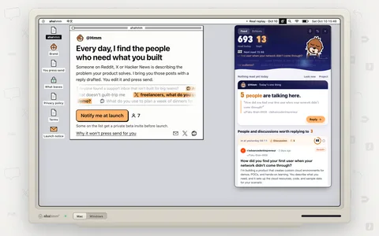</a>

🔍 [在 Builderoom 查看详情](https://www.builderoom.com/zh-CN/product/ahahmm?utm_source=github&utm_medium=weekly&utm_campaign=weekly-001) · 🔗 [官网](https://ahahmm.ai/?ref=builderoom&utm_source=builderoom&utm_medium=referral&utm_campaign=weekly)

---

### 2.  `Web` 樱桃茶·智域GPT

一个账号使用 GPT、Claude、Gemini、Grok 等 33 个 AI 模型，支持对话、画图、音乐、视频和知识库。

🔍 [在 Builderoom 查看详情](https://www.builderoom.com/zh-CN/product/gpt?utm_source=github&utm_medium=weekly&utm_campaign=weekly-001) · 🔗 [官网](https://new.cherrychat.org/v2/home/?ref=builderoom&utm_source=builderoom&utm_medium=referral&utm_campaign=weekly)

---

### 3.  `Web` YinsoAI

基于想法或歌词生成原创歌曲的 AI 音乐创作网页应用

🔍 [在 Builderoom 查看详情](https://www.builderoom.com/zh-CN/product/yinsoai?utm_source=github&utm_medium=weekly&utm_campaign=weekly-001) · 🔗 [官网](https://yinso.ai/?ref=builderoom&utm_source=builderoom&utm_medium=referral&utm_campaign=weekly)

---

### 4.  `Web` Araveil

多模型 AI 工作台，在一个界面中与多个模型对话、构建项目并生成图像。

🔍 [在 Builderoom 查看详情](https://www.builderoom.com/zh-CN/product/araveil?utm_source=github&utm_medium=weekly&utm_campaign=weekly-001) · 🔗 [官网](https://araveil.ai/?ref=builderoom&utm_source=builderoom&utm_medium=referral&utm_campaign=weekly)

---

### 5.  `Web` CoverUpInk

为想遮盖旧纹身的人提供300多个设计灵感，并支持上传照片生成AI遮盖方案。

🔍 [在 Builderoom 查看详情](https://www.builderoom.com/zh-CN/product/coverupink?utm_source=github&utm_medium=weekly&utm_campaign=weekly-001) · 🔗 [官网](https://coverupink.com/?ref=builderoom&utm_source=builderoom&utm_medium=referral&utm_campaign=weekly)

---

### 6.  `iOS/Android` 咖啡人 · 每日咖啡记录

为咖啡爱好者提供的极简记录应用，用贴纸方式追踪每日咖啡与咖啡因摄入。

🔍 [在 Builderoom 查看详情](https://www.builderoom.com/zh-CN/product/p-63514e0f9a?utm_source=github&utm_medium=weekly&utm_campaign=weekly-001) · 🔗 [App Store](https://apps.apple.com/cn/app/%E5%92%96%E5%95%A1%E4%BA%BA-%E6%AF%8F%E6%97%A5%E5%92%96%E5%95%A1%E8%AE%B0%E5%BD%95/id6757520656?ref=builderoom&utm_source=builderoom&utm_medium=referral&utm_campaign=weekly)

---

### 7.  `桌面端` BaoCode

为 Claude Code 提供原生桌面 UI，内置毫秒级启动的 IDE。

<a href="https://www.builderoom.com/zh-CN/product/baocode?utm_source=github&amp;utm_medium=weekly&amp;utm_campaign=weekly-001">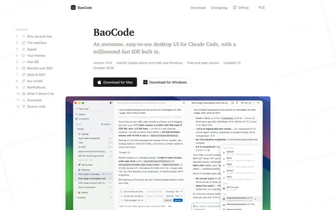</a>
<a href="https://www.builderoom.com/zh-CN/product/baocode?utm_source=github&amp;utm_medium=weekly&amp;utm_campaign=weekly-001">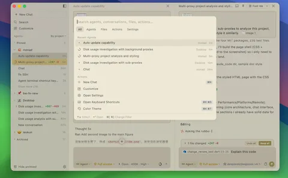</a>

🔍 [在 Builderoom 查看详情](https://www.builderoom.com/zh-CN/product/baocode?utm_source=github&utm_medium=weekly&utm_campaign=weekly-001) · 🔗 [GitHub](https://github.com/baocode-dev/baocode?ref=builderoom&utm_source=builderoom&utm_medium=referral&utm_campaign=weekly)

---

### 8.  `桌面端` Casbin Gateway

监控本机所有 AI 编程代理的行为，验证其背后 API 的真实性并管理权限与用量。

🔍 [在 Builderoom 查看详情](https://www.builderoom.com/zh-CN/product/casbin-gateway?utm_source=github&utm_medium=weekly&utm_campaign=weekly-001) · 🔗 [GitHub](https://github.com/apache/casbin-gateway?ref=builderoom&utm_source=builderoom&utm_medium=referral&utm_campaign=weekly)

---

### 9. <a href="https://www.builderoom.com/zh-CN/product/momoapi?utm_source=github&amp;utm_medium=weekly&amp;utm_campaign=weekly-001">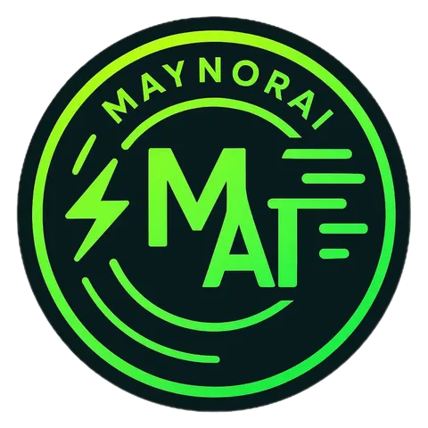</a> `Web` MomoAPI

提供透明按量计费模式的 API 中转服务，用户只为实际使用的服务付费。

🔍 [在 Builderoom 查看详情](https://www.builderoom.com/zh-CN/product/momoapi?utm_source=github&utm_medium=weekly&utm_campaign=weekly-001) · 🔗 [官网](https://tryallapi.com/pricing?ref=builderoom&utm_source=builderoom&utm_medium=referral&utm_campaign=weekly)

---

### 10.  `Web` PDF to Link

将 PDF 上传为可分享的翻页阅读页面，并追踪读者的阅读行为数据。

<a href="https://www.builderoom.com/zh-CN/product/pdf-to-link?utm_source=github&amp;utm_medium=weekly&amp;utm_campaign=weekly-001">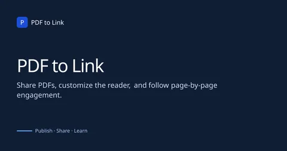</a>

🔍 [在 Builderoom 查看详情](https://www.builderoom.com/zh-CN/product/pdf-to-link?utm_source=github&utm_medium=weekly&utm_campaign=weekly-001) · 🔗 [官网](https://pdf-to-link.com/?ref=builderoom&utm_source=builderoom&utm_medium=referral&utm_campaign=weekly)

---

### 11.  `Web` TxtDock

免费在线文本工具集，提供大小写转换、HTML 转 Markdown、Base64、JSON 格式化等二十余款工具。

🔍 [在 Builderoom 查看详情](https://www.builderoom.com/zh-CN/product/txtdock?utm_source=github&utm_medium=weekly&utm_campaign=weekly-001) · 🔗 [官网](https://txtdock.com/zh?ref=builderoom&utm_source=builderoom&utm_medium=referral&utm_campaign=weekly)

---

### 12.  `Web` Picser

macOS 原生图片查看器，支持快速浏览、EXIF 查看、裁剪、旋转、标签与筛选。

<a href="https://www.builderoom.com/zh-CN/product/picser?utm_source=github&amp;utm_medium=weekly&amp;utm_campaign=weekly-001">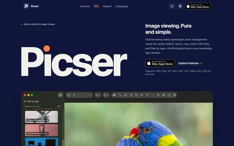</a>
<a href="https://www.builderoom.com/zh-CN/product/picser?utm_source=github&amp;utm_medium=weekly&amp;utm_campaign=weekly-001">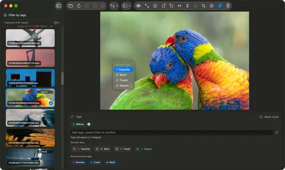</a>

🔍 [在 Builderoom 查看详情](https://www.builderoom.com/zh-CN/product/picser?utm_source=github&utm_medium=weekly&utm_campaign=weekly-001) · 🔗 [官网](https://picser.app/en-US/?ref=builderoom&utm_source=builderoom&utm_medium=referral&utm_campaign=weekly)

---

### 13.  `Web` EditTextPhoto

AI 驱动的图片文字编辑器，可在保留原始字体、颜色、大小和样式的前提下，编辑、替换、修正或翻译图片中的文字。

<a href="https://www.builderoom.com/zh-CN/product/edittextphoto?utm_source=github&amp;utm_medium=weekly&amp;utm_campaign=weekly-001">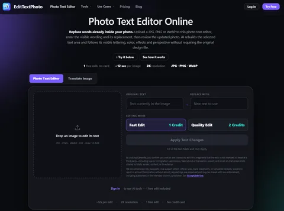</a>

🔍 [在 Builderoom 查看详情](https://www.builderoom.com/zh-CN/product/edittextphoto?utm_source=github&utm_medium=weekly&utm_campaign=weekly-001) · 🔗 [官网](https://edittextphoto.com/?ref=builderoom&utm_source=builderoom&utm_medium=referral&utm_campaign=weekly)

---

### 14.  `Web` Skillry

浏览用 Claude Opus 5.5 制作的视频，对比原版与重制版并复制创作者使用的提示词。

🔍 [在 Builderoom 查看详情](https://www.builderoom.com/zh-CN/product/skillry?utm_source=github&utm_medium=weekly&utm_campaign=weekly-001) · 🔗 [官网](https://skillry.dev/ai-videos/opus-5-5?ref=builderoom&utm_source=builderoom&utm_medium=referral&utm_campaign=weekly)

---

### 15.  `Web` cetxt

面向中文站长的 llms.txt 生成、检查与部署助手

🔍 [在 Builderoom 查看详情](https://www.builderoom.com/zh-CN/product/cetxt?utm_source=github&utm_medium=weekly&utm_campaign=weekly-001) · 🔗 [官网](https://cetxt.com/?ref=builderoom&utm_source=builderoom&utm_medium=referral&utm_campaign=weekly)

---

### 16.  `桌面端` IINA

基于 mpv 的现代 macOS 视频播放器，支持字幕、画中画与插件扩展。

<a href="https://www.builderoom.com/zh-CN/product/iina?utm_source=github&amp;utm_medium=weekly&amp;utm_campaign=weekly-001">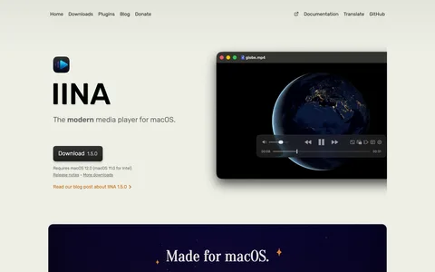</a>
<a href="https://www.builderoom.com/zh-CN/product/iina?utm_source=github&amp;utm_medium=weekly&amp;utm_campaign=weekly-001">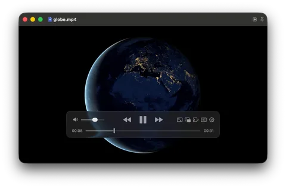</a>

🔍 [在 Builderoom 查看详情](https://www.builderoom.com/zh-CN/product/iina?utm_source=github&utm_medium=weekly&utm_campaign=weekly-001) · 🔗 [GitHub](https://github.com/iina/iina?ref=builderoom&utm_source=builderoom&utm_medium=referral&utm_campaign=weekly)

---

### 17.  `Web` Raindance AI Video Generator

上传两张照片，生成包含码头等待、唱歌和海滩日落场景的 Raindance 趋势视频。

🔍 [在 Builderoom 查看详情](https://www.builderoom.com/zh-CN/product/raindance-ai-video-generator?utm_source=github&utm_medium=weekly&utm_campaign=weekly-001) · 🔗 [官网](https://raindanceaivideo.app/?ref=builderoom&utm_source=builderoom&utm_medium=referral&utm_campaign=weekly)

---

### 18.  `iOS/Android` 小鹿足迹 - 记录生活轨迹，探索世界足迹

利用位置追踪和 AI 技术自动记录日常活动与轨迹的 iOS 日记应用。

🔍 [在 Builderoom 查看详情](https://www.builderoom.com/zh-CN/product/p-bfb8309f14?utm_source=github&utm_medium=weekly&utm_campaign=weekly-001) · 🔗 [App Store](https://apps.apple.com/cn/app/%E5%B0%8F%E9%B9%BF%E8%B6%B3%E8%BF%B9-%E8%AE%B0%E5%BD%95%E7%94%9F%E6%B4%BB%E8%BD%A8%E8%BF%B9-%E6%8E%A2%E7%B4%A2%E4%B8%96%E7%95%8C%E8%B6%B3%E8%BF%B9/id6481981341?ref=builderoom&utm_source=builderoom&utm_medium=referral&utm_campaign=weekly)

---

### 19.  `Web` Pixsolo

面向 iOS / Android 开发者的免安装 Web 端应用商店截图设计平台

<a href="https://www.builderoom.com/zh-CN/product/pixsolo-3?utm_source=github&amp;utm_medium=weekly&amp;utm_campaign=weekly-001">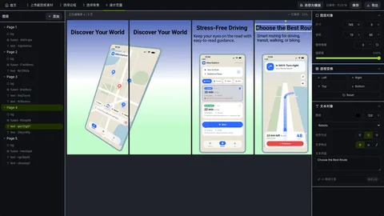</a>

🔍 [在 Builderoom 查看详情](https://www.builderoom.com/zh-CN/product/pixsolo-3?utm_source=github&utm_medium=weekly&utm_campaign=weekly-001) · 🔗 [官网](https://www.pixsolo.com/?ref=builderoom&utm_source=builderoom&utm_medium=referral&utm_campaign=weekly)

---

### 20.  `iOS/Android` WhatsFeel

一款由 AI 驱动的冥想、睡眠与放松应用，结合心率数据动态生成语音引导。

🔍 [在 Builderoom 查看详情](https://www.builderoom.com/zh-CN/product/whatsfeel?utm_source=github&utm_medium=weekly&utm_campaign=weekly-001) · 🔗 [App Store](https://apps.apple.com/cn/app/whatsfeel/id6762454965?ref=builderoom&utm_source=builderoom&utm_medium=referral&utm_campaign=weekly)

---

### 21.  `iOS/Android` WordHub

为英语学习者打造的离线词典与单词学习工具，支持导入 MDict 词典。

<a href="https://www.builderoom.com/zh-CN/product/wordhub?utm_source=github&amp;utm_medium=weekly&amp;utm_campaign=weekly-001">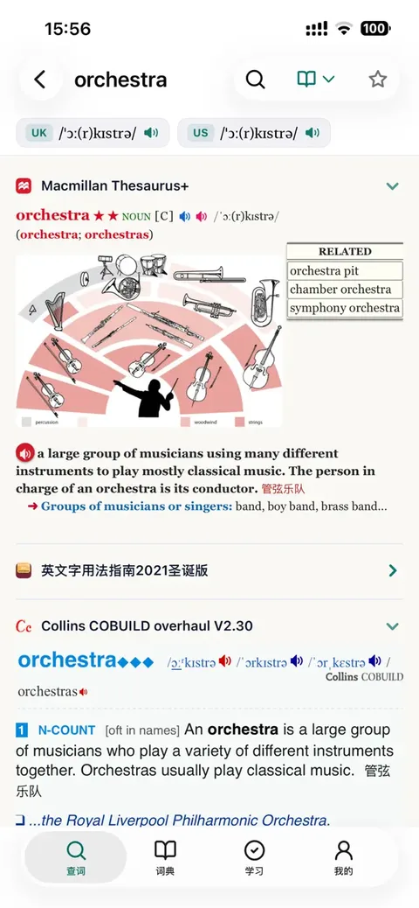</a>

🔍 [在 Builderoom 查看详情](https://www.builderoom.com/zh-CN/product/wordhub?utm_source=github&utm_medium=weekly&utm_campaign=weekly-001) · 🔗 [App Store](https://apps.apple.com/cn/app/wordhub/id6812649164?ref=builderoom&utm_source=builderoom&utm_medium=referral&utm_campaign=weekly)

---

### 22.  `Web` Hotel Lobby AI Video Generator

上传两张照片，生成8秒竖屏AI视频，将人物或宠物放入橙色录音棚场景中。

🔍 [在 Builderoom 查看详情](https://www.builderoom.com/zh-CN/product/hotel-lobby-ai-video-generator?utm_source=github&utm_medium=weekly&utm_campaign=weekly-001) · 🔗 [官网](https://myhotellobbyai.com/?ref=builderoom&utm_source=builderoom&utm_medium=referral&utm_campaign=weekly)

---

### 23.  `Web` GIF Downloader

在线下载社交平台视频与 GIF，或在浏览器中将 MP4 转换为 GIF。

🔍 [在 Builderoom 查看详情](https://www.builderoom.com/zh-CN/product/gif-downloader?utm_source=github&utm_medium=weekly&utm_campaign=weekly-001) · 🔗 [官网](https://gif-downloader.app/?ref=builderoom&utm_source=builderoom&utm_medium=referral&utm_campaign=weekly)

---

### 24.  `Web` AddressGen

为开发、演示和表单测试生成随机的美国和日本示例地址及联系方式。

🔍 [在 Builderoom 查看详情](https://www.builderoom.com/zh-CN/product/addressgen?utm_source=github&utm_medium=weekly&utm_campaign=weekly-001) · 🔗 [官网](https://addressgen.net/?ref=builderoom&utm_source=builderoom&utm_medium=referral&utm_campaign=weekly)

---

### 25.  `插件` Mearl

面向开发者的浏览器扩展，提供网页检查、请求调试与页面行为验证能力

<a href="https://www.builderoom.com/zh-CN/product/mearl?utm_source=github&amp;utm_medium=weekly&amp;utm_campaign=weekly-001">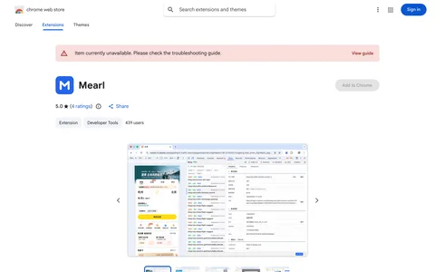</a>

🔍 [在 Builderoom 查看详情](https://www.builderoom.com/zh-CN/product/mearl?utm_source=github&utm_medium=weekly&utm_campaign=weekly-001) · 🔗 [Chrome 网上应用店](https://chromewebstore.google.com/detail/aoehhjnofngknnjefamjbplchbolghkm?ref=builderoom&utm_source=builderoom&utm_medium=referral&utm_campaign=weekly)

---

### 26.  `CLI` catbus

用统一命令操作小红书、抖音、B站等10个平台的命令行工具，为人和AI Agent提供一致的JSON输出。

🔍 [在 Builderoom 查看详情](https://www.builderoom.com/zh-CN/product/catbus?utm_source=github&utm_medium=weekly&utm_campaign=weekly-001) · 🔗 [GitHub](https://github.com/cv-cat/catbus?ref=builderoom&utm_source=builderoom&utm_medium=referral&utm_campaign=weekly)

---

### 27.  `Web` purpole.cn 赛道地图打印

一个赛道地图编辑器

<a href="https://www.builderoom.com/zh-CN/product/purpole-cn?utm_source=github&amp;utm_medium=weekly&amp;utm_campaign=weekly-001">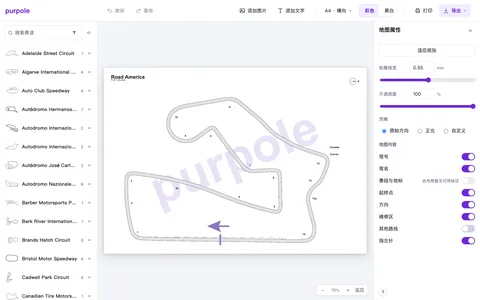</a>

🔍 [在 Builderoom 查看详情](https://www.builderoom.com/zh-CN/product/purpole-cn?utm_source=github&utm_medium=weekly&utm_campaign=weekly-001) · 🔗 [官网](https://purpole.cn/map-editor/?ref=builderoom&utm_source=builderoom&utm_medium=referral&utm_campaign=weekly)

---

### 28.  `Web` BetterOPC

面向超级个体的 AI 与科技情报平台，提供资讯、榜单、创作素材及 AI 产品额度活动。

🔍 [在 Builderoom 查看详情](https://www.builderoom.com/zh-CN/product/betteropc?utm_source=github&utm_medium=weekly&utm_campaign=weekly-001) · 🔗 [官网](https://betteropc.com/?ref=builderoom&utm_source=builderoom&utm_medium=referral&utm_campaign=weekly)

---

### 29.  `桌面端` Nowdex

在 Mac、iPhone、iPad 和 Windows 上追踪多个 AI 服务的用量与配额。

🔍 [在 Builderoom 查看详情](https://www.builderoom.com/zh-CN/product/nowdex?utm_source=github&utm_medium=weekly&utm_campaign=weekly-001) · 🔗 [官网](https://nowdex.app/?ref=builderoom&utm_source=builderoom&utm_medium=referral&utm_campaign=weekly)

---

### 30.  `桌面端` Caplo

一款 Mac 录屏工具，录制时记录点击与指针轨迹并自动生成推近与跟随镜头。

<a href="https://www.builderoom.com/zh-CN/product/caplo?utm_source=github&amp;utm_medium=weekly&amp;utm_campaign=weekly-001">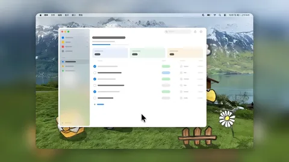</a>

🔍 [在 Builderoom 查看详情](https://www.builderoom.com/zh-CN/product/caplo?utm_source=github&utm_medium=weekly&utm_campaign=weekly-001) · 🔗 [官网](https://caplo.app/?ref=builderoom&utm_source=builderoom&utm_medium=referral&utm_campaign=weekly)

---

[← 往期回顾](../README.md) · 浏览更多作品：[builderoom.com](https://www.builderoom.com/zh-CN?utm_source=github&utm_medium=weekly&utm_campaign=weekly-001)
