<!-- builderoom-weekly issue=2 start=2026-10-12 end=2026-10-18 -->
# Builderoom 周精选 · 第 2 期

> 2026-10-12 ~ 2026-10-18 · 本期收录 **30** 款新作品

[Builderoom](https://www.builderoom.com/zh-CN?utm_source=github&utm_medium=weekly&utm_campaign=weekly-002)：始于独立创造，开启无限连接。这里展示独立开发者、设计师与创客的作品，每一款都经过人工审核后上架。

> [!TIP]
> **自荐作品**：在 Builderoom [提交你的作品](https://www.builderoom.com/zh-CN/submit?utm_source=github&utm_medium=weekly&utm_campaign=weekly-002)，审核通过后即有机会入选下一期周刊。

---

### 1.  `桌面端` Compositor

面向 Mac 用户的免费开源图像编辑器，提供类似 Photoshop 的图层合成与后期处理工作流。

<a href="https://www.builderoom.com/zh-CN/product/compositor?utm_source=github&amp;utm_medium=weekly&amp;utm_campaign=weekly-002">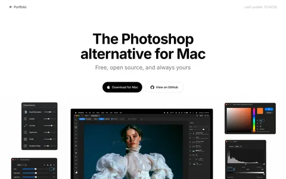</a>

🔍 [在 Builderoom 查看详情](https://www.builderoom.com/zh-CN/product/compositor?utm_source=github&utm_medium=weekly&utm_campaign=weekly-002) · 🔗 [GitHub](https://github.com/robbietilton/Compositor?ref=builderoom&utm_source=builderoom&utm_medium=referral&utm_campaign=weekly)

---

### 2.  `Web` todo.is

通过 WhatsApp、Telegram、Slack、Discord 或网页向 AI 代理发送待办事项，由其自动完成。

🔍 [在 Builderoom 查看详情](https://www.builderoom.com/zh-CN/product/todo-is?utm_source=github&utm_medium=weekly&utm_campaign=weekly-002) · 🔗 [官网](https://todo.is/?ref=builderoom&utm_source=builderoom&utm_medium=referral&utm_campaign=weekly)

---

### 3.  `Web` PiriPiri AI

实时监听面试双方对话并在屏幕共享时隐藏的桌面端 AI 面试辅助工具。

🔍 [在 Builderoom 查看详情](https://www.builderoom.com/zh-CN/product/piripiri-ai?utm_source=github&utm_medium=weekly&utm_campaign=weekly-002) · 🔗 [官网](https://piripiriai.com/?ref=builderoom&utm_source=builderoom&utm_medium=referral&utm_campaign=weekly)

---

### 4.  `Web` Pip

一款 Mac 桌面 AI 助手，能看懂屏幕并用语音引导你找到要点击的位置。

🔍 [在 Builderoom 查看详情](https://www.builderoom.com/zh-CN/product/pip?utm_source=github&utm_medium=weekly&utm_campaign=weekly-002) · 🔗 [官网](https://hipip.app/?ref=builderoom&utm_source=builderoom&utm_medium=referral&utm_campaign=weekly)

---

### 5.  `Web` pdoomvideo

输入一句话，自动生成由 AI 导演并绘制的原动物音乐视频。

🔍 [在 Builderoom 查看详情](https://www.builderoom.com/zh-CN/product/pdoomvideo?utm_source=github&utm_medium=weekly&utm_campaign=weekly-002) · 🔗 [官网](https://pdoomvideo.com/?ref=builderoom&utm_source=builderoom&utm_medium=referral&utm_campaign=weekly)

---

### 6.  `Web` Inkspo

免费 AI 纹身设计生成器，将想法在几秒内转化为纹身图案，无需注册。

<a href="https://www.builderoom.com/zh-CN/product/inkspo?utm_source=github&amp;utm_medium=weekly&amp;utm_campaign=weekly-002">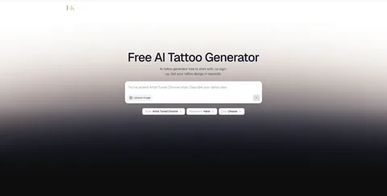</a>
<a href="https://www.builderoom.com/zh-CN/product/inkspo?utm_source=github&amp;utm_medium=weekly&amp;utm_campaign=weekly-002">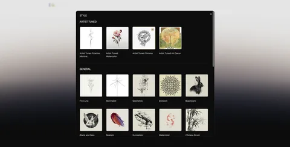</a>

🔍 [在 Builderoom 查看详情](https://www.builderoom.com/zh-CN/product/inkspo?utm_source=github&utm_medium=weekly&utm_campaign=weekly-002) · 🔗 [官网](https://inkspo.ai/?ref=builderoom&utm_source=builderoom&utm_medium=referral&utm_campaign=weekly)

---

### 7.  `Web` Kleep

AI 歌曲生成器，将文本、歌词或想法转化为带人声的完整原创歌曲。

<a href="https://www.builderoom.com/zh-CN/product/kleep?utm_source=github&amp;utm_medium=weekly&amp;utm_campaign=weekly-002">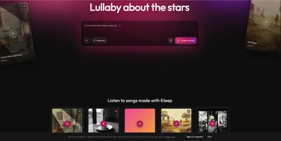</a>

🔍 [在 Builderoom 查看详情](https://www.builderoom.com/zh-CN/product/kleep?utm_source=github&utm_medium=weekly&utm_campaign=weekly-002) · 🔗 [官网](https://kleep.art/?ref=builderoom&utm_source=builderoom&utm_medium=referral&utm_campaign=weekly)

---

### 8.  `Web` WebEXE

在线将 HTML 文件或静态网页项目转换为 Windows EXE 桌面应用。

🔍 [在 Builderoom 查看详情](https://www.builderoom.com/zh-CN/product/webexe?utm_source=github&utm_medium=weekly&utm_campaign=weekly-002) · 🔗 [官网](https://webexe.cc/zh/?ref=builderoom&utm_source=builderoom&utm_medium=referral&utm_campaign=weekly)

---

### 9.  `Web` Lulu Board

基于文本协议的结构化白板，让 AI 与用户在画布上协作绘图并保持同步。

🔍 [在 Builderoom 查看详情](https://www.builderoom.com/zh-CN/product/lulu-board?utm_source=github&utm_medium=weekly&utm_campaign=weekly-002) · 🔗 [官网](https://github.com/lulufoo/lulu-board?ref=builderoom&utm_source=builderoom&utm_medium=referral&utm_campaign=weekly)

---

### 10.  `Web` Mermaid Live Editor

免费的浏览器端 Mermaid 图表编辑器，支持实时预览、模板、导出与链接分享。

<a href="https://www.builderoom.com/zh-CN/product/mermaid-live-editor?utm_source=github&amp;utm_medium=weekly&amp;utm_campaign=weekly-002">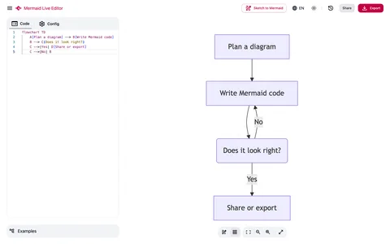</a>

🔍 [在 Builderoom 查看详情](https://www.builderoom.com/zh-CN/product/mermaid-live-editor?utm_source=github&utm_medium=weekly&utm_campaign=weekly-002) · 🔗 [官网](https://mermaid-live-editor.com/?ref=builderoom&utm_source=builderoom&utm_medium=referral&utm_campaign=weekly)

---

### 11.  `Web` jev-seo

输入一个首页 URL，对网站进行实时 SEO 审计并生成 PDF、XLSX 和 Markdown 报告。

🔍 [在 Builderoom 查看详情](https://www.builderoom.com/zh-CN/product/jev-seo?utm_source=github&utm_medium=weekly&utm_campaign=weekly-002) · 🔗 [官网](https://github.com/AgriciDaniel/jev-seo?ref=builderoom&utm_source=builderoom&utm_medium=referral&utm_campaign=weekly)

---

### 12.  `桌面端` magpie

为 AI 编程代理提供统一的本地网关，在菜单栏中切换不同模型与提供商。

<a href="https://www.builderoom.com/zh-CN/product/magpie?utm_source=github&amp;utm_medium=weekly&amp;utm_campaign=weekly-002">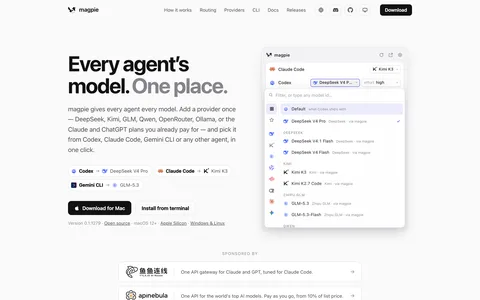</a>

🔍 [在 Builderoom 查看详情](https://www.builderoom.com/zh-CN/product/magpie?utm_source=github&utm_medium=weekly&utm_campaign=weekly-002) · 🔗 [GitHub](https://github.com/yetone/magpie?ref=builderoom&utm_source=builderoom&utm_medium=referral&utm_campaign=weekly)

---

### 13.  `AI Agent` native-subtitle-quote-image

保留视频内嵌字幕，精确取帧并生成社交长图的 Agent Skill

🔍 [在 Builderoom 查看详情](https://www.builderoom.com/zh-CN/product/native-subtitle-quote-image?utm_source=github&utm_medium=weekly&utm_campaign=weekly-002) · 🔗 [GitHub](https://github.com/chengyi-ai/native-subtitle-quote-image?ref=builderoom&utm_source=builderoom&utm_medium=referral&utm_campaign=weekly)

---

### 14.  `Web` Freebuff

免费的 AI 编程代理，支持在浏览器、桌面端或终端中编写、构建和部署应用。

<a href="https://www.builderoom.com/zh-CN/product/freebuff?utm_source=github&amp;utm_medium=weekly&amp;utm_campaign=weekly-002">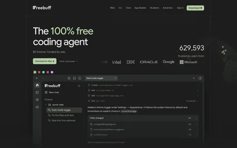</a>

🔍 [在 Builderoom 查看详情](https://www.builderoom.com/zh-CN/product/freebuff?utm_source=github&utm_medium=weekly&utm_campaign=weekly-002) · 🔗 [官网](https://freebuff.com/?ref=builderoom&utm_source=builderoom&utm_medium=referral&utm_campaign=weekly)

---

### 15. <a href="https://www.builderoom.com/zh-CN/product/tubeai?utm_source=github&amp;utm_medium=weekly&amp;utm_campaign=weekly-002">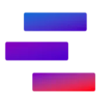</a> `Web` TubeAI

面向 YouTube 创作者的 AI 平台，提供选题、脚本、缩略图生成及频道数据分析功能。

🔍 [在 Builderoom 查看详情](https://www.builderoom.com/zh-CN/product/tubeai?utm_source=github&utm_medium=weekly&utm_campaign=weekly-002) · 🔗 [官网](https://tubeai.app/?ref=builderoom&utm_source=builderoom&utm_medium=referral&utm_campaign=weekly)

---

### 16.  `Web` Cue

为个人提供拥有独立邮箱、电话、钱包和电脑的 AI Agent，处理日常事务。

🔍 [在 Builderoom 查看详情](https://www.builderoom.com/zh-CN/product/cue?utm_source=github&utm_medium=weekly&utm_campaign=weekly-002) · 🔗 [官网](https://cue.im/?ref=builderoom&utm_source=builderoom&utm_medium=referral&utm_campaign=weekly)

---

### 17.  `Web` CourseCrafter AI

面向教练、培训师和教育者的 AI 课程生成器，将 PDF、笔记或主题转化为可编辑的在线课程。

🔍 [在 Builderoom 查看详情](https://www.builderoom.com/zh-CN/product/coursecrafter-ai?utm_source=github&utm_medium=weekly&utm_campaign=weekly-002) · 🔗 [官网](https://coursecrafter.makeproductive.com/?ref=builderoom&utm_source=builderoom&utm_medium=referral&utm_campaign=weekly)

---

### 18.  `Web` Yila AI

面向研究人员的 AI 工具，覆盖文献检索、阅读、数据分析、写作与演示文稿生成。

<a href="https://www.builderoom.com/zh-CN/product/yila-ai?utm_source=github&amp;utm_medium=weekly&amp;utm_campaign=weekly-002">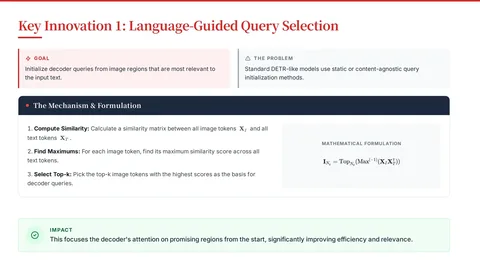</a>

🔍 [在 Builderoom 查看详情](https://www.builderoom.com/zh-CN/product/yila-ai?utm_source=github&utm_medium=weekly&utm_campaign=weekly-002) · 🔗 [官网](https://yila.ai/?ref=builderoom&utm_source=builderoom&utm_medium=referral&utm_campaign=weekly)

---

### 19.  `Web` MakeAIVideo

通过提示词、脚本或图片生成 AI 视频，并自动发布到多个社交平台。

🔍 [在 Builderoom 查看详情](https://www.builderoom.com/zh-CN/product/makeaivideo?utm_source=github&utm_medium=weekly&utm_campaign=weekly-002) · 🔗 [官网](https://makeaivideo.ai/?ref=builderoom&utm_source=builderoom&utm_medium=referral&utm_campaign=weekly)

---

### 20.  `Web` Burning Bridges AI Video Generator

上传一张照片，将自己、朋友、宠物或角色放入 Burning Bridges 派对场景视频中。

🔍 [在 Builderoom 查看详情](https://www.builderoom.com/zh-CN/product/burning-bridges-ai-video-generator?utm_source=github&utm_medium=weekly&utm_campaign=weekly-002) · 🔗 [官网](https://burning-bridges.net/?ref=builderoom&utm_source=builderoom&utm_medium=referral&utm_campaign=weekly)

---

### 21.  `Web` Video To Frames

在浏览器中从视频中提取帧，支持多种导出模式，无需上传文件。

🔍 [在 Builderoom 查看详情](https://www.builderoom.com/zh-CN/product/video-to-frames?utm_source=github&utm_medium=weekly&utm_campaign=weekly-002) · 🔗 [官网](https://videotoframes.io/?ref=builderoom&utm_source=builderoom&utm_medium=referral&utm_campaign=weekly)

---

### 22.  `Web` AI Zombie Video Generator

上传两张照片，生成一段15秒的AI僵尸趋势视频，单次付费，无需订阅。

🔍 [在 Builderoom 查看详情](https://www.builderoom.com/zh-CN/product/ai-zombie-video-generator?utm_source=github&utm_medium=weekly&utm_campaign=weekly-002) · 🔗 [官网](https://zombieaivideo.app/?ref=builderoom&utm_source=builderoom&utm_medium=referral&utm_campaign=weekly)

---

### 23.  `Web` Archify

开源 AI Agent 技能，从自然语言或源码生成可交互的独立 HTML 图表。

🔍 [在 Builderoom 查看详情](https://www.builderoom.com/zh-CN/product/archify?utm_source=github&utm_medium=weekly&utm_campaign=weekly-002) · 🔗 [官网](https://archify.si/zh?ref=builderoom&utm_source=builderoom&utm_medium=referral&utm_campaign=weekly)

---

### 24.  `Web` Online Video Editor

在浏览器中免费编辑本地视频，无需登录、不上传文件。

🔍 [在 Builderoom 查看详情](https://www.builderoom.com/zh-CN/product/online-video-editor?utm_source=github&utm_medium=weekly&utm_campaign=weekly-002) · 🔗 [官网](https://www.freeonlinevideoeditor.app/?ref=builderoom&utm_source=builderoom&utm_medium=referral&utm_campaign=weekly)

---

### 25.  `Web` PixelTokb

在线将 JPEG、PNG、WebP 图片压缩到指定的 KB 目标大小，处理过程在浏览器本地完成。

<a href="https://www.builderoom.com/zh-CN/product/pixeltokb?utm_source=github&amp;utm_medium=weekly&amp;utm_campaign=weekly-002">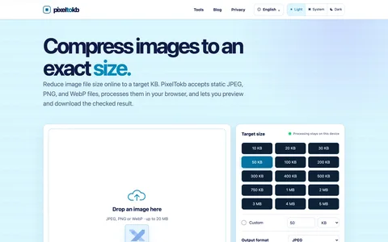</a>

🔍 [在 Builderoom 查看详情](https://www.builderoom.com/zh-CN/product/pixeltokb?utm_source=github&utm_medium=weekly&utm_campaign=weekly-002) · 🔗 [官网](https://www.pixeltokb.com/?ref=builderoom&utm_source=builderoom&utm_medium=referral&utm_campaign=weekly)

---

### 26.  `iOS/Android` 摄影学英语

将日常照片转化为英语学习素材，通过识别画面物品生成双语词汇卡片。

<a href="https://www.builderoom.com/zh-CN/product/p-93eb3f0287?utm_source=github&amp;utm_medium=weekly&amp;utm_campaign=weekly-002">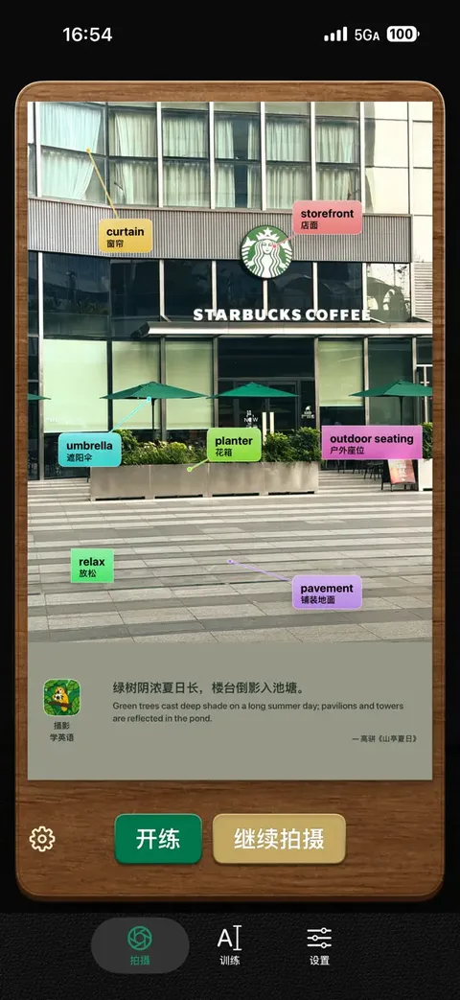</a>

🔍 [在 Builderoom 查看详情](https://www.builderoom.com/zh-CN/product/p-93eb3f0287?utm_source=github&utm_medium=weekly&utm_campaign=weekly-002) · 🔗 [App Store](https://apps.apple.com/cn/app/%E6%91%84%E5%BD%B1%E5%AD%A6%E8%8B%B1%E8%AF%AD/id6808490052?ref=builderoom&utm_source=builderoom&utm_medium=referral&utm_campaign=weekly)

---

### 27.  `Web` AI Zombie Couple Video Generator

将两张人像照片转化为15秒的丧尸末日主题爱情短视频。

🔍 [在 Builderoom 查看详情](https://www.builderoom.com/zh-CN/product/ai-zombie-couple-video-generator?utm_source=github&utm_medium=weekly&utm_campaign=weekly-002) · 🔗 [官网](https://zombie-couple-video.art/?ref=builderoom&utm_source=builderoom&utm_medium=referral&utm_campaign=weekly)

---

### 28.  `Web` AITraining.jobs

聚合各平台 AI 训练岗位，提供按角色、平台和地区对比的真实时薪数据。

<a href="https://www.builderoom.com/zh-CN/product/aitraining-jobs?utm_source=github&amp;utm_medium=weekly&amp;utm_campaign=weekly-002">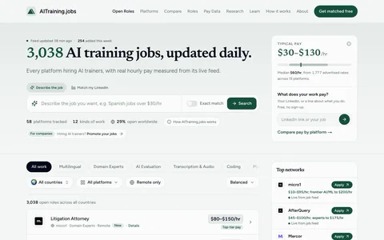</a>

🔍 [在 Builderoom 查看详情](https://www.builderoom.com/zh-CN/product/aitraining-jobs?utm_source=github&utm_medium=weekly&utm_campaign=weekly-002) · 🔗 [官网](https://aitraining.jobs/?ref=builderoom&utm_source=builderoom&utm_medium=referral&utm_campaign=weekly)

---

### 29.  `桌面端` 爆创AI

内容研究与创作助手，帮助创作者整理参考素材、拆解选题与表达，为创作找到思路。

🔍 [在 Builderoom 查看详情](https://www.builderoom.com/zh-CN/product/ai-e676358c?utm_source=github&utm_medium=weekly&utm_campaign=weekly-002) · 🔗 [官网](https://baochuangai.com/?ref=builderoom&utm_source=builderoom&utm_medium=referral&utm_campaign=weekly)

---

### 30.  `Web` TrustMRR

一个用于买卖 SaaS、应用和数字业务的交易平台，提供经过验证的收入与增长数据。

🔍 [在 Builderoom 查看详情](https://www.builderoom.com/zh-CN/product/trustmrr?utm_source=github&utm_medium=weekly&utm_campaign=weekly-002) · 🔗 [官网](https://trustmrr.com/?ref=builderoom&utm_source=builderoom&utm_medium=referral&utm_campaign=weekly)

---

[← 往期回顾](../README.md) · 浏览更多作品：[builderoom.com](https://www.builderoom.com/zh-CN?utm_source=github&utm_medium=weekly&utm_campaign=weekly-002)
