<!-- builderoom-weekly issue=3 start=2026-10-19 end=2026-10-25 -->
# Builderoom 周精选 · 第 3 期

> 2026-10-19 ~ 2026-10-25 · 本期收录 **30** 款新作品

[Builderoom](https://www.builderoom.com/zh-CN?utm_source=github&utm_medium=weekly&utm_campaign=weekly-003)：始于独立创造，开启无限连接。这里展示独立开发者、设计师与创客的作品，每一款都经过人工审核后上架。

> [!TIP]
> **自荐作品**：在 Builderoom [提交你的作品](https://www.builderoom.com/zh-CN/submit?utm_source=github&utm_medium=weekly&utm_campaign=weekly-003)，审核通过后即有机会入选下一期周刊。

---

### 1.  `Web` Higgsfield AI Video Generator

在一个平台集成多个 AI 视频模型，为创作者提供逐帧控制的视频生成工具。

🔍 [在 Builderoom 查看详情](https://www.builderoom.com/zh-CN/product/higgsfield-ai-video-generator?utm_source=github&utm_medium=weekly&utm_campaign=weekly-003) · 🔗 [官网](https://higgsfield.ai/ai-video?ref=builderoom&utm_source=builderoom&utm_medium=referral&utm_campaign=weekly)

---

### 2.  `Web` Doc2X

在线文档工作台，用于解析 PDF 与图片、翻译文档、处理公式表格及 AI 对话。

🔍 [在 Builderoom 查看详情](https://www.builderoom.com/zh-CN/product/doc2x-2?utm_source=github&utm_medium=weekly&utm_campaign=weekly-003) · 🔗 [官网](https://doc2x.noedgeai.com/?ref=builderoom&utm_source=builderoom&utm_medium=referral&utm_campaign=weekly)

---

### 3.  `Web` FloorAI

将草图、照片或 PDF 转换为可编辑的平面图，并支持后续手动调整。

<a href="https://www.builderoom.com/zh-CN/product/floorai?utm_source=github&amp;utm_medium=weekly&amp;utm_campaign=weekly-003">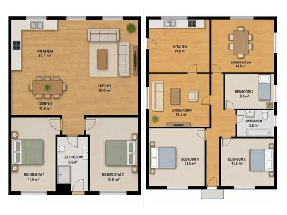</a>
<a href="https://www.builderoom.com/zh-CN/product/floorai?utm_source=github&amp;utm_medium=weekly&amp;utm_campaign=weekly-003">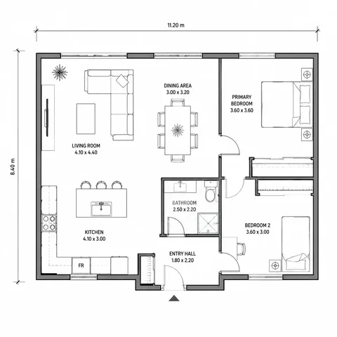</a>

🔍 [在 Builderoom 查看详情](https://www.builderoom.com/zh-CN/product/floorai?utm_source=github&utm_medium=weekly&utm_campaign=weekly-003) · 🔗 [官网](https://www.floorai.ai/?ref=builderoom&utm_source=builderoom&utm_medium=referral&utm_campaign=weekly)

---

### 4.  `AI Agent` Vectoree

Give your coding agent a backend — models, auth, database and storage in one cloud.

<a href="https://www.builderoom.com/zh-CN/product/vectoree?utm_source=github&amp;utm_medium=weekly&amp;utm_campaign=weekly-003">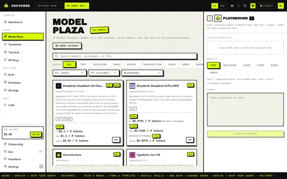</a>
<a href="https://www.builderoom.com/zh-CN/product/vectoree?utm_source=github&amp;utm_medium=weekly&amp;utm_campaign=weekly-003">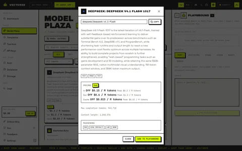</a>

🔍 [在 Builderoom 查看详情](https://www.builderoom.com/zh-CN/product/vectoree?utm_source=github&utm_medium=weekly&utm_campaign=weekly-003) · 🔗 [官网](https://vectoree.ai?ref=builderoom&utm_source=builderoom&utm_medium=referral&utm_campaign=weekly)

---

### 5.  `Web` LaunchProof

在网站或应用上线前，跨设备和浏览器检测问题并生成修复报告

<a href="https://www.builderoom.com/zh-CN/product/launchproof?utm_source=github&amp;utm_medium=weekly&amp;utm_campaign=weekly-003">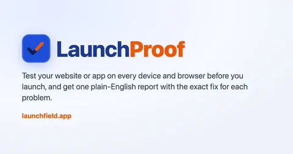</a>

🔍 [在 Builderoom 查看详情](https://www.builderoom.com/zh-CN/product/launchproof?utm_source=github&utm_medium=weekly&utm_campaign=weekly-003) · 🔗 [官网](https://launchfield.app/?ref=builderoom&utm_source=builderoom&utm_medium=referral&utm_campaign=weekly)

---

### 6.  `桌面端` CityRT

一款免费的城市建设桌面游戏，支持单人游玩或与朋友在线联机。

🔍 [在 Builderoom 查看详情](https://www.builderoom.com/zh-CN/product/cityrt?utm_source=github&utm_medium=weekly&utm_campaign=weekly-003) · 🔗 [官网](https://cityrt.com/en/?ref=builderoom&utm_source=builderoom&utm_medium=referral&utm_campaign=weekly)

---

### 7.  `Web` ArtCraft

面向艺术家的开源 AI 图像与视频生成工具，提供可控的创作流程。

<a href="https://www.builderoom.com/zh-CN/product/artcraft?utm_source=github&amp;utm_medium=weekly&amp;utm_campaign=weekly-003">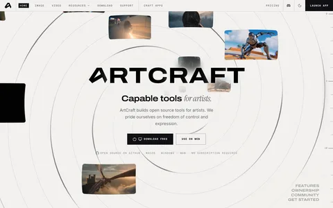</a>

🔍 [在 Builderoom 查看详情](https://www.builderoom.com/zh-CN/product/artcraft?utm_source=github&utm_medium=weekly&utm_campaign=weekly-003) · 🔗 [官网](https://getartcraft.com/?ref=builderoom&utm_source=builderoom&utm_medium=referral&utm_campaign=weekly)

---

### 8.  `iOS/Android` 余课 yohaku

给国内大学生用的 Android 课程表，一屏看全一周，支持多种导入方式。

<a href="https://www.builderoom.com/zh-CN/product/yohaku?utm_source=github&amp;utm_medium=weekly&amp;utm_campaign=weekly-003">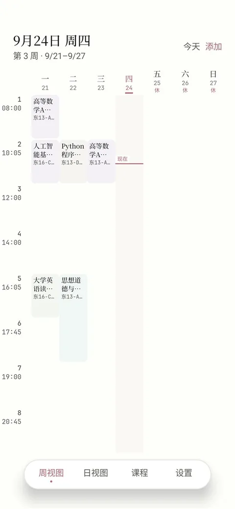</a>

🔍 [在 Builderoom 查看详情](https://www.builderoom.com/zh-CN/product/yohaku?utm_source=github&utm_medium=weekly&utm_campaign=weekly-003) · 🔗 [其他](https://classtable.kspace.eu.org?ref=builderoom&utm_source=builderoom&utm_medium=referral&utm_campaign=weekly)

---

### 9.  `桌面端` Arnis

基于 OpenStreetMap 数据，将真实世界的地理位置生成为 Minecraft 存档的桌面工具。

🔍 [在 Builderoom 查看详情](https://www.builderoom.com/zh-CN/product/arnis?utm_source=github&utm_medium=weekly&utm_campaign=weekly-003) · 🔗 [GitHub](https://github.com/louis-e/arnis?ref=builderoom&utm_source=builderoom&utm_medium=referral&utm_campaign=weekly)

---

### 10.  `Web` TranscribeBee

按量付费的 AI 音视频转写工具，支持 90+ 语言，每小时 2 美元，无需订阅。

<a href="https://www.builderoom.com/zh-CN/product/transcribebee?utm_source=github&amp;utm_medium=weekly&amp;utm_campaign=weekly-003">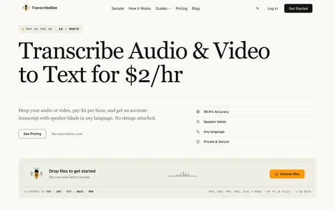</a>

🔍 [在 Builderoom 查看详情](https://www.builderoom.com/zh-CN/product/transcribebee?utm_source=github&utm_medium=weekly&utm_campaign=weekly-003) · 🔗 [官网](https://transcribebee.com/?ref=builderoom&utm_source=builderoom&utm_medium=referral&utm_campaign=weekly)

---

### 11. <a href="https://www.builderoom.com/zh-CN/product/a2md?utm_source=github&amp;utm_medium=weekly&amp;utm_campaign=weekly-003">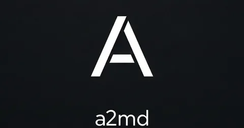</a> `Web` a2md

将多平台视频或本地音视频一键转为带时间戳的转写稿与结构化 AI 学习笔记。

🔍 [在 Builderoom 查看详情](https://www.builderoom.com/zh-CN/product/a2md?utm_source=github&utm_medium=weekly&utm_campaign=weekly-003) · 🔗 [官网](https://a2md.my/?ref=builderoom&utm_source=builderoom&utm_medium=referral&utm_campaign=weekly)

---

### 12.  `Web` M3E Canvas

在浏览器中绘制 Material 3 Expressive 界面，并生成供 AI 编程工具使用的 prompt。

<a href="https://www.builderoom.com/zh-CN/product/m3e-canvas?utm_source=github&amp;utm_medium=weekly&amp;utm_campaign=weekly-003">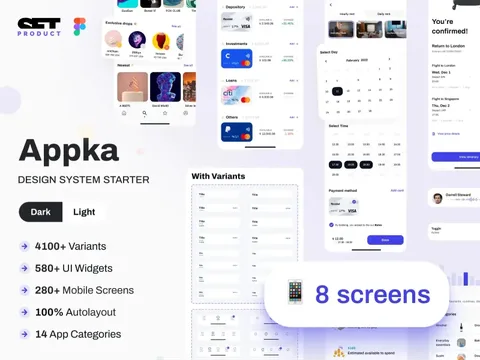</a>
<a href="https://www.builderoom.com/zh-CN/product/m3e-canvas?utm_source=github&amp;utm_medium=weekly&amp;utm_campaign=weekly-003">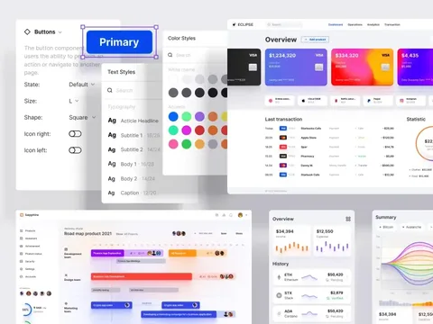</a>

🔍 [在 Builderoom 查看详情](https://www.builderoom.com/zh-CN/product/m3e-canvas?utm_source=github&utm_medium=weekly&utm_campaign=weekly-003) · 🔗 [官网](https://github.com/lnkiai/m3e-canvas?ref=builderoom&utm_source=builderoom&utm_medium=referral&utm_campaign=weekly)

---

### 13.  `Web` NovaGen3D

基于浏览器的 AI 3D 模型生成与编辑工作区，支持从文本或图片创建、细化并转换 3D 文件。

🔍 [在 Builderoom 查看详情](https://www.builderoom.com/zh-CN/product/novagen3d?utm_source=github&utm_medium=weekly&utm_campaign=weekly-003) · 🔗 [官网](https://www.novagen3d.com/?ref=builderoom&utm_source=builderoom&utm_medium=referral&utm_campaign=weekly)

---

### 14.  `iOS/Android` B-Panel

安卓版定时运行Python/Js脚本，脚本调度(参考青龙面板)，同时内置Agent功能，支持操作管理本项目和自定义插件，内置支付宝免挂支付收款

🔍 [在 Builderoom 查看详情](https://www.builderoom.com/zh-CN/product/b-panel?utm_source=github&utm_medium=weekly&utm_campaign=weekly-003) · 🔗 [其他](https://241793.github.io/B-Panel?ref=builderoom&utm_source=builderoom&utm_medium=referral&utm_campaign=weekly)

---

### 15.  `Web` Pazi

通过 AI Agent 团队将商业想法转化为实际业务，在一个仪表盘中规划、执行并推进工作。

🔍 [在 Builderoom 查看详情](https://www.builderoom.com/zh-CN/product/pazi?utm_source=github&utm_medium=weekly&utm_campaign=weekly-003) · 🔗 [官网](https://pazi.ai/?ref=builderoom&utm_source=builderoom&utm_medium=referral&utm_campaign=weekly)

---

### 16.  `Web` AdHub

基于 AI 的视频广告生成与剪辑工具，支持一句话生成动画广告或一键剪辑真人视频。

🔍 [在 Builderoom 查看详情](https://www.builderoom.com/zh-CN/product/adhub?utm_source=github&utm_medium=weekly&utm_campaign=weekly-003) · 🔗 [官网](https://adhub.cloud/?ref=builderoom&utm_source=builderoom&utm_medium=referral&utm_campaign=weekly)

---

### 17.  `AI Agent` Eimu

一句话到成片的 AI 影像工作台，AI 智能体自动拆解剧本、角色、分镜并生成图片、视频与配音。

🔍 [在 Builderoom 查看详情](https://www.builderoom.com/zh-CN/product/eimu?utm_source=github&utm_medium=weekly&utm_campaign=weekly-003) · 🔗 [官网](https://eimu.dev?ref=builderoom&utm_source=builderoom&utm_medium=referral&utm_campaign=weekly)

---

### 18.  `Web` ColorCraft

为 Amazon KDP 自出版者提供 AI 驱动的涂色书、故事书和谜题书生成平台。

🔍 [在 Builderoom 查看详情](https://www.builderoom.com/zh-CN/product/colorcraft?utm_source=github&utm_medium=weekly&utm_campaign=weekly-003) · 🔗 [官网](https://colorcraft.ai/?ref=builderoom&utm_source=builderoom&utm_medium=referral&utm_campaign=weekly)

---

### 19.  `Web` Easel

面向社交媒体创作者的开源 AI 内容工作台，覆盖发现、策划、创作、发布与复盘全流程。

🔍 [在 Builderoom 查看详情](https://www.builderoom.com/zh-CN/product/easel?utm_source=github&utm_medium=weekly&utm_campaign=weekly-003) · 🔗 [官网](https://github.com/ZJU-REAL/Easel?ref=builderoom&utm_source=builderoom&utm_medium=referral&utm_campaign=weekly)

---

### 20.  `Web` 软考星图

为软考考生提供知识导图、论文范文与真题练习的网页应用

🔍 [在 Builderoom 查看详情](https://www.builderoom.com/zh-CN/product/p-8872ae5c21?utm_source=github&utm_medium=weekly&utm_campaign=weekly-003) · 🔗 [官网](https://ruankao.dpdns.org?ref=builderoom&utm_source=builderoom&utm_medium=referral&utm_campaign=weekly)

---

### 21.  `AI Agent` video-shotcraft

为 Claude Code 和 Codex 提供的 AI 视频技能，用 Remotion 将产品页面生成可编辑的宣传视频。

🔍 [在 Builderoom 查看详情](https://www.builderoom.com/zh-CN/product/video-shotcraft?utm_source=github&utm_medium=weekly&utm_campaign=weekly-003) · 🔗 [GitHub](https://github.com/Vincentwei1021/video-shotcraft?ref=builderoom&utm_source=builderoom&utm_medium=referral&utm_campaign=weekly)

---

### 22.  `Web` SVGConverter

免费在线工具，将 PNG、JPG 等光栅图像转换为 SVG、AI、EPS 等矢量图形。

<a href="https://www.builderoom.com/zh-CN/product/svgconverter?utm_source=github&amp;utm_medium=weekly&amp;utm_campaign=weekly-003">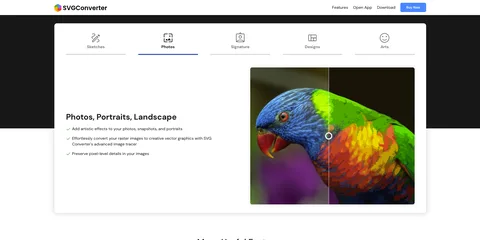</a>
<a href="https://www.builderoom.com/zh-CN/product/svgconverter?utm_source=github&amp;utm_medium=weekly&amp;utm_campaign=weekly-003">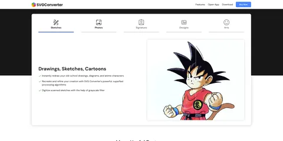</a>

🔍 [在 Builderoom 查看详情](https://www.builderoom.com/zh-CN/product/svgconverter?utm_source=github&utm_medium=weekly&utm_campaign=weekly-003) · 🔗 [官网](https://svgconverter.app/?ref=builderoom&utm_source=builderoom&utm_medium=referral&utm_campaign=weekly)

---

### 23.  `桌面端` DbCat

用 Rust 编写的原生 macOS 数据库客户端，支持 MySQL、PostgreSQL、Redis、MongoDB 等 12 种数据库。

<a href="https://www.builderoom.com/zh-CN/product/dbcat?utm_source=github&amp;utm_medium=weekly&amp;utm_campaign=weekly-003">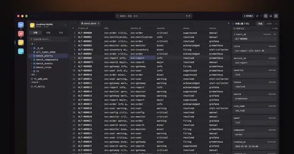</a>

🔍 [在 Builderoom 查看详情](https://www.builderoom.com/zh-CN/product/dbcat?utm_source=github&utm_medium=weekly&utm_campaign=weekly-003) · 🔗 [官网](https://dbcat.forzens.com/?ref=builderoom&utm_source=builderoom&utm_medium=referral&utm_campaign=weekly)

---

### 24. <a href="https://www.builderoom.com/zh-CN/product/capvant?utm_source=github&amp;utm_medium=weekly&amp;utm_campaign=weekly-003">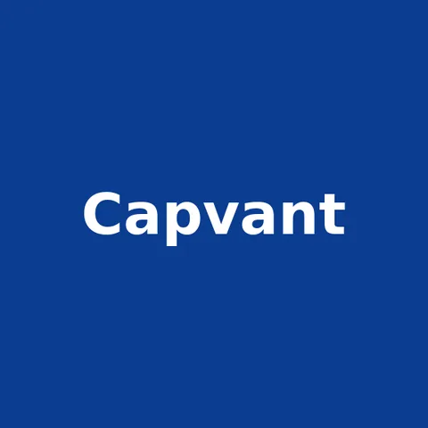</a> `Web` Capvant

一站式比较中小企业融资方案

<a href="https://www.builderoom.com/zh-CN/product/capvant?utm_source=github&amp;utm_medium=weekly&amp;utm_campaign=weekly-003">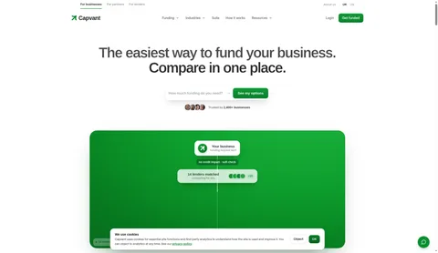</a>

🔍 [在 Builderoom 查看详情](https://www.builderoom.com/zh-CN/product/capvant?utm_source=github&utm_medium=weekly&utm_campaign=weekly-003) · 🔗 [官网](https://capvant.com?ref=builderoom&utm_source=builderoom&utm_medium=referral&utm_campaign=weekly)

---

### 25.  `插件` OpenMontage

将 AI 编程助手转化为视频制作工作室的开源 Agent 系统

🔍 [在 Builderoom 查看详情](https://www.builderoom.com/zh-CN/product/openmontage?utm_source=github&utm_medium=weekly&utm_campaign=weekly-003) · 🔗 [GitHub](https://github.com/calesthio/OpenMontage?ref=builderoom&utm_source=builderoom&utm_medium=referral&utm_campaign=weekly)

---

### 26.  `Web` ChineseBQB

中国人的表情包集合，按分类找图、搜索、预览和保存表情包。

<a href="https://www.builderoom.com/zh-CN/product/chinesebqb?utm_source=github&amp;utm_medium=weekly&amp;utm_campaign=weekly-003">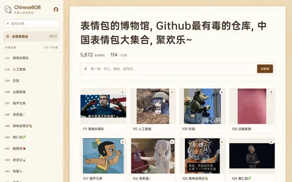</a>

🔍 [在 Builderoom 查看详情](https://www.builderoom.com/zh-CN/product/chinesebqb?utm_source=github&utm_medium=weekly&utm_campaign=weekly-003) · 🔗 [官网](https://zhaoolee.com/ChineseBQB/?ref=builderoom&utm_source=builderoom&utm_medium=referral&utm_campaign=weekly)

---

### 27.  `CLI` PR-Agent

开源 AI 代码审查工具，帮助开发者自动审查 Pull Request 并提供改进建议。

🔍 [在 Builderoom 查看详情](https://www.builderoom.com/zh-CN/product/pr-agent?utm_source=github&utm_medium=weekly&utm_campaign=weekly-003) · 🔗 [GitHub](https://github.com/The-PR-Agent/pr-agent?ref=builderoom&utm_source=builderoom&utm_medium=referral&utm_campaign=weekly)

---

### 28.  `Web` Viberot

上传照片，利用 AI 模型生成短视频、GIF 动图和风格化图片的网页应用。

🔍 [在 Builderoom 查看详情](https://www.builderoom.com/zh-CN/product/viberot?utm_source=github&utm_medium=weekly&utm_campaign=weekly-003) · 🔗 [官网](https://viberot.com/?ref=builderoom&utm_source=builderoom&utm_medium=referral&utm_campaign=weekly)

---

### 29.  `AI Agent` Anatomy

一个 AI 技能，将技术概念转化为可交互的等距 SVG、WebGL 和 3D 插图。

<a href="https://www.builderoom.com/zh-CN/product/anatomy?utm_source=github&amp;utm_medium=weekly&amp;utm_campaign=weekly-003">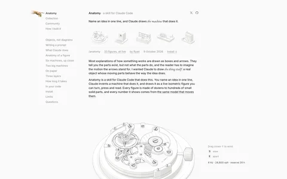</a>
<a href="https://www.builderoom.com/zh-CN/product/anatomy?utm_source=github&amp;utm_medium=weekly&amp;utm_campaign=weekly-003">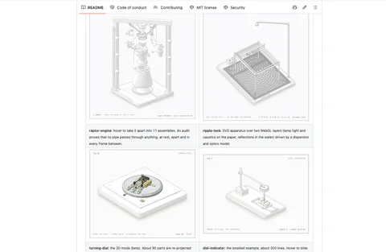</a>

🔍 [在 Builderoom 查看详情](https://www.builderoom.com/zh-CN/product/anatomy?utm_source=github&utm_medium=weekly&utm_campaign=weekly-003) · 🔗 [GitHub](https://github.com/wheresryan22/anatomy?ref=builderoom&utm_source=builderoom&utm_medium=referral&utm_campaign=weekly)

---

### 30.  `Web` VideoTextRemover

在线 AI 工具，从 MP4 和 MOV 视频中移除烧录字幕、标题等屏幕文字并重建背景画面。

🔍 [在 Builderoom 查看详情](https://www.builderoom.com/zh-CN/product/videotextremover?utm_source=github&utm_medium=weekly&utm_campaign=weekly-003) · 🔗 [官网](https://videotextremover.ai/?ref=builderoom&utm_source=builderoom&utm_medium=referral&utm_campaign=weekly)

---

[← 往期回顾](../README.md) · 浏览更多作品：[builderoom.com](https://www.builderoom.com/zh-CN?utm_source=github&utm_medium=weekly&utm_campaign=weekly-003)
