<!-- builderoom-weekly issue=4 start=2026-10-26 end=2026-11-01 -->
# Builderoom 周精选 · 第 4 期

> 2026-10-26 ~ 2026-11-01 · 本期收录 **30** 款新作品

[Builderoom](https://www.builderoom.com/zh-CN?utm_source=github&utm_medium=weekly&utm_campaign=weekly-004)：始于独立创造，开启无限连接。这里展示独立开发者、设计师与创客的作品，每一款都经过人工审核后上架。

> [!TIP]
> **自荐作品**：在 Builderoom [提交你的作品](https://www.builderoom.com/zh-CN/submit?utm_source=github&utm_medium=weekly&utm_campaign=weekly-004)，审核通过后即有机会入选下一期周刊。

---

### 1.  `Web` Genie 4

Google DeepMind 推出的新一代世界模型，支持实时交互式世界模拟与原生音频生成。

<a href="https://www.builderoom.com/zh-CN/product/genie-4?utm_source=github&amp;utm_medium=weekly&amp;utm_campaign=weekly-004">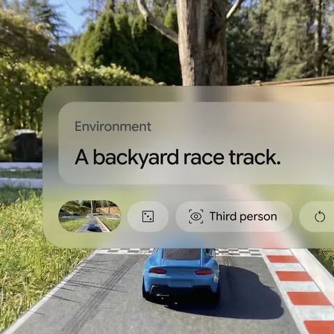</a>

🔍 [在 Builderoom 查看详情](https://www.builderoom.com/zh-CN/product/genie-4?utm_source=github&utm_medium=weekly&utm_campaign=weekly-004) · 🔗 [官网](https://deepmind.google/blog/genie-4-a-new-generation-of-world-simulation/?ref=builderoom&utm_source=builderoom&utm_medium=referral&utm_campaign=weekly)

---

### 2. <a href="https://www.builderoom.com/zh-CN/product/motion-transfer?utm_source=github&amp;utm_medium=weekly&amp;utm_campaign=weekly-004">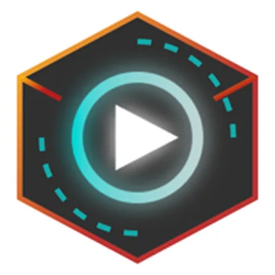</a> `Web` Motion Transfer

一键将照片变成爆款 AI 视频趋势

<a href="https://www.builderoom.com/zh-CN/product/motion-transfer?utm_source=github&amp;utm_medium=weekly&amp;utm_campaign=weekly-004">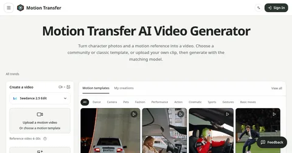</a>

🔍 [在 Builderoom 查看详情](https://www.builderoom.com/zh-CN/product/motion-transfer?utm_source=github&utm_medium=weekly&utm_campaign=weekly-004) · 🔗 [官网](https://www.motiontransfer.app/?ref=builderoom&utm_source=builderoom&utm_medium=referral&utm_campaign=weekly)

---

### 3.  `Web` DeepTutor

基于多智能体与 RAG 的个性化 AI 辅导系统，支持文档解析、交互式学习与深度研究。

<a href="https://www.builderoom.com/zh-CN/product/deeptutor?utm_source=github&amp;utm_medium=weekly&amp;utm_campaign=weekly-004">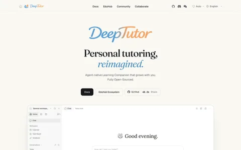</a>
<a href="https://www.builderoom.com/zh-CN/product/deeptutor?utm_source=github&amp;utm_medium=weekly&amp;utm_campaign=weekly-004">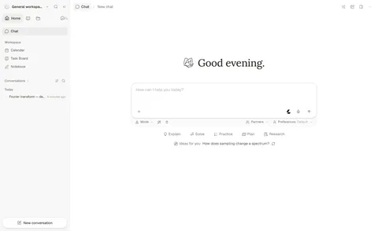</a>

🔍 [在 Builderoom 查看详情](https://www.builderoom.com/zh-CN/product/deeptutor?utm_source=github&utm_medium=weekly&utm_campaign=weekly-004) · 🔗 [官网](https://github.com/HKUDS/DeepTutor?ref=builderoom&utm_source=builderoom&utm_medium=referral&utm_campaign=weekly)

---

### 4.  `Web` Genjutsu AI

用你的人物、宠物或产品，重新演绎任意视频

🔍 [在 Builderoom 查看详情](https://www.builderoom.com/zh-CN/product/genjutsu-ai?utm_source=github&utm_medium=weekly&utm_campaign=weekly-004) · 🔗 [官网](https://aigenjutsu.app/?ref=builderoom&utm_source=builderoom&utm_medium=referral&utm_campaign=weekly)

---

### 5.  `Web` tiny desk AI

上传照片，将自己和朋友替换到 Outstanding 桌面音乐会 meme 视频中。

🔍 [在 Builderoom 查看详情](https://www.builderoom.com/zh-CN/product/tiny-desk-ai-2?utm_source=github&utm_medium=weekly&utm_campaign=weekly-004) · 🔗 [官网](https://aitinydesk.io/?ref=builderoom&utm_source=builderoom&utm_medium=referral&utm_campaign=weekly)

---

### 6.  `Web` Edit Image Text

用 AI 在线编辑图片中的文字，替换内容并匹配原始风格。

<a href="https://www.builderoom.com/zh-CN/product/edit-image-text?utm_source=github&amp;utm_medium=weekly&amp;utm_campaign=weekly-004">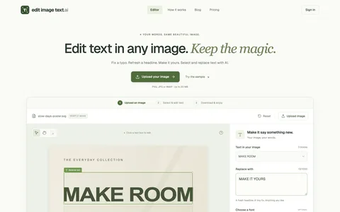</a>
<a href="https://www.builderoom.com/zh-CN/product/edit-image-text?utm_source=github&amp;utm_medium=weekly&amp;utm_campaign=weekly-004">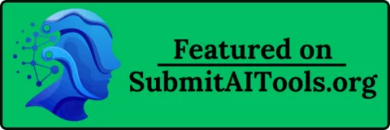</a>

🔍 [在 Builderoom 查看详情](https://www.builderoom.com/zh-CN/product/edit-image-text?utm_source=github&utm_medium=weekly&utm_campaign=weekly-004) · 🔗 [官网](https://editimagetext.ai/?ref=builderoom&utm_source=builderoom&utm_medium=referral&utm_campaign=weekly)

---

### 7.  `Web` Video Background Changer

在线 AI 视频背景移除与替换工具，无需注册即可导出透明或纯色背景视频。

<a href="https://www.builderoom.com/zh-CN/product/video-background-changer?utm_source=github&amp;utm_medium=weekly&amp;utm_campaign=weekly-004">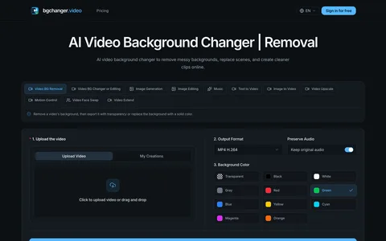</a>

🔍 [在 Builderoom 查看详情](https://www.builderoom.com/zh-CN/product/video-background-changer?utm_source=github&utm_medium=weekly&utm_campaign=weekly-004) · 🔗 [官网](https://bgchanger.video/?ref=builderoom&utm_source=builderoom&utm_medium=referral&utm_campaign=weekly)

---

### 8.  `Web` ReelMuse

基于浏览器的 AI 视频生成工具，支持文本、图片和视频输入，可调用多种模型生成并下载视频。

🔍 [在 Builderoom 查看详情](https://www.builderoom.com/zh-CN/product/reelmuse?utm_source=github&utm_medium=weekly&utm_campaign=weekly-004) · 🔗 [官网](https://reelmuse.app/?ref=builderoom&utm_source=builderoom&utm_medium=referral&utm_campaign=weekly)

---

### 9.  `Web` Confido Health

面向医疗和牙科机构的 Agentic AI 系统，自动化患者预约与收入周期工作流。

<a href="https://www.builderoom.com/zh-CN/product/confido-health?utm_source=github&amp;utm_medium=weekly&amp;utm_campaign=weekly-004">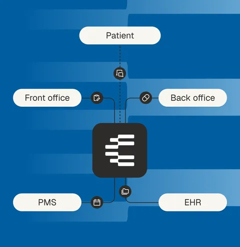</a>

🔍 [在 Builderoom 查看详情](https://www.builderoom.com/zh-CN/product/confido-health?utm_source=github&utm_medium=weekly&utm_campaign=weekly-004) · 🔗 [官网](https://www.confido.health/?ref=builderoom&utm_source=builderoom&utm_medium=referral&utm_campaign=weekly)

---

### 10.  `Web` Reference to Video

将参考视频与你的照片合成一段全新短片

🔍 [在 Builderoom 查看详情](https://www.builderoom.com/zh-CN/product/reference-to-video?utm_source=github&utm_medium=weekly&utm_campaign=weekly-004) · 🔗 [官网](https://reference2video.com/?ref=builderoom&utm_source=builderoom&utm_medium=referral&utm_campaign=weekly)

---

### 11.  `Web` PixRemove

用 AI 去除图片背景和多余物体，免费使用、无需注册、无水印。

<a href="https://www.builderoom.com/zh-CN/product/pixremove?utm_source=github&amp;utm_medium=weekly&amp;utm_campaign=weekly-004">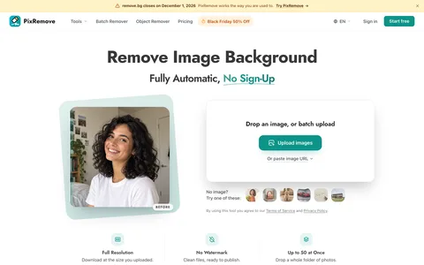</a>

🔍 [在 Builderoom 查看详情](https://www.builderoom.com/zh-CN/product/pixremove?utm_source=github&utm_medium=weekly&utm_campaign=weekly-004) · 🔗 [官网](https://pixremove.com/?ref=builderoom&utm_source=builderoom&utm_medium=referral&utm_campaign=weekly)

---

### 12.  `Web` Athena

一个通过倾听而非观看的助手，帮助用户了解当下重要的事情。

<a href="https://www.builderoom.com/zh-CN/product/athena?utm_source=github&amp;utm_medium=weekly&amp;utm_campaign=weekly-004">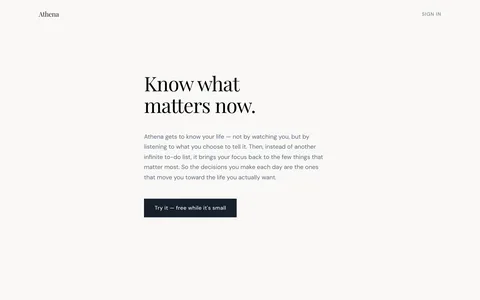</a>

🔍 [在 Builderoom 查看详情](https://www.builderoom.com/zh-CN/product/athena?utm_source=github&utm_medium=weekly&utm_campaign=weekly-004) · 🔗 [官网](https://athenaos.net/?ref=builderoom&utm_source=builderoom&utm_medium=referral&utm_campaign=weekly)

---

### 13.  `Web` Cinely: AI Film &amp; Movie Maker

将故事创意转化为 AI 短片，同时提供创作者内容观看与变现平台。

<a href="https://www.builderoom.com/zh-CN/product/cinely-ai-film-movie-maker?utm_source=github&amp;utm_medium=weekly&amp;utm_campaign=weekly-004">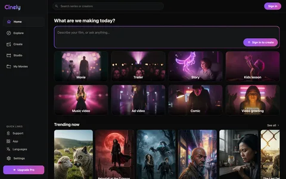</a>

🔍 [在 Builderoom 查看详情](https://www.builderoom.com/zh-CN/product/cinely-ai-film-movie-maker?utm_source=github&utm_medium=weekly&utm_campaign=weekly-004) · 🔗 [官网](https://www.cinelyai.com/?ref=builderoom&utm_source=builderoom&utm_medium=referral&utm_campaign=weekly)

---

### 14.  `桌面端` pixtuoid

在终端中以像素风办公室的形式可视化监控多个 AI 编程 Agent 的状态。

<a href="https://www.builderoom.com/zh-CN/product/pixtuoid?utm_source=github&amp;utm_medium=weekly&amp;utm_campaign=weekly-004">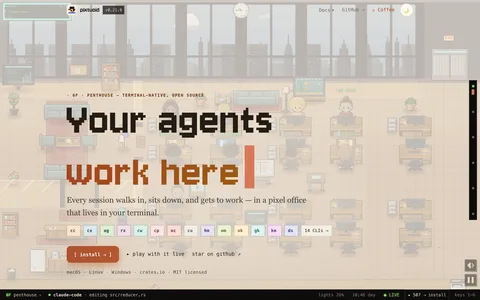</a>
<a href="https://www.builderoom.com/zh-CN/product/pixtuoid?utm_source=github&amp;utm_medium=weekly&amp;utm_campaign=weekly-004">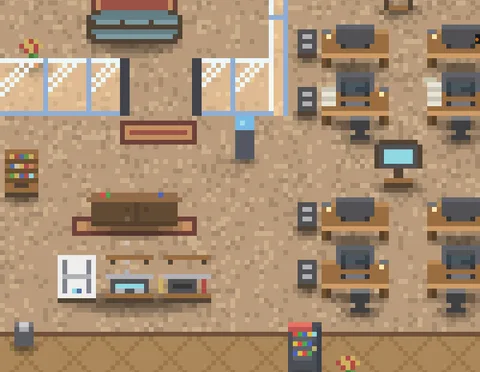</a>

🔍 [在 Builderoom 查看详情](https://www.builderoom.com/zh-CN/product/pixtuoid?utm_source=github&utm_medium=weekly&utm_campaign=weekly-004) · 🔗 [GitHub](https://github.com/pixtuoid/pixtuoid?ref=builderoom&utm_source=builderoom&utm_medium=referral&utm_campaign=weekly)

---

### 15.  `iOS/Android` Auday - Watch全天AI录音

将 Apple Watch 变为全天候 AI 录音设备，记录声音与健康数据，并在本地进行回顾与反思。

<a href="https://www.builderoom.com/zh-CN/product/auday-watch-ai?utm_source=github&amp;utm_medium=weekly&amp;utm_campaign=weekly-004">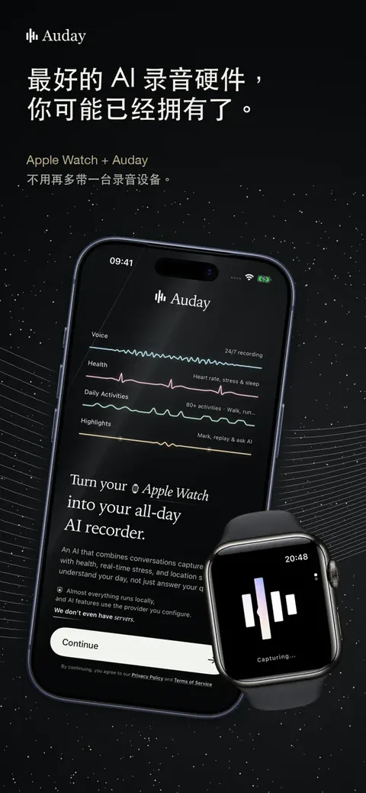</a>
<a href="https://www.builderoom.com/zh-CN/product/auday-watch-ai?utm_source=github&amp;utm_medium=weekly&amp;utm_campaign=weekly-004">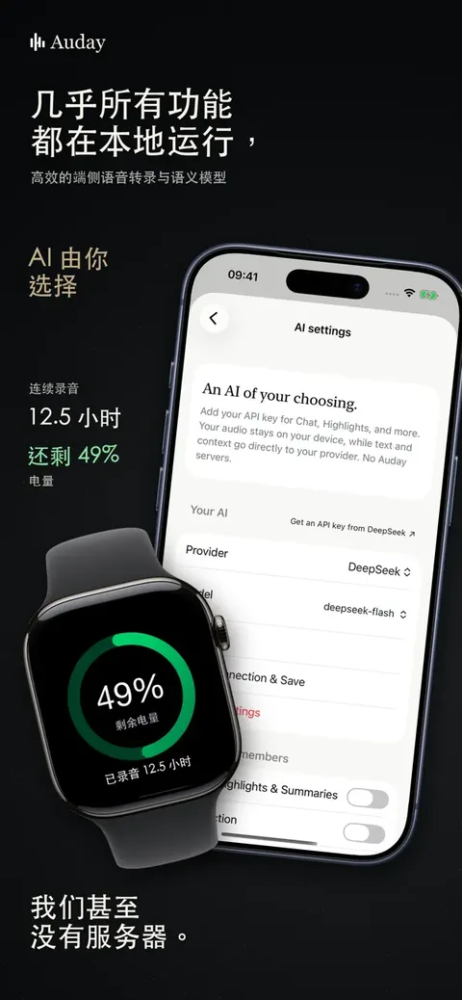</a>

🔍 [在 Builderoom 查看详情](https://www.builderoom.com/zh-CN/product/auday-watch-ai?utm_source=github&utm_medium=weekly&utm_campaign=weekly-004) · 🔗 [App Store](https://apps.apple.com/cn/app/auday-watch%E5%85%A8%E5%A4%A9ai%E5%BD%95%E9%9F%B3/id6814210373?ref=builderoom&utm_source=builderoom&utm_medium=referral&utm_campaign=weekly)

---

### 16. <a href="https://www.builderoom.com/zh-CN/product/polsia?utm_source=github&amp;utm_medium=weekly&amp;utm_campaign=weekly-004">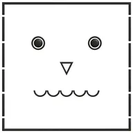</a> `Web` Polsia

通过协调多个 AI Agent 自主规划、编码和营销，全天候运行公司的 AI 系统。

<a href="https://www.builderoom.com/zh-CN/product/polsia?utm_source=github&amp;utm_medium=weekly&amp;utm_campaign=weekly-004">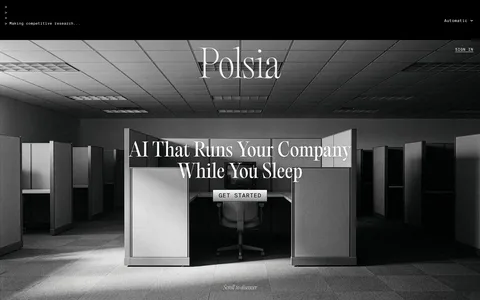</a>

🔍 [在 Builderoom 查看详情](https://www.builderoom.com/zh-CN/product/polsia?utm_source=github&utm_medium=weekly&utm_campaign=weekly-004) · 🔗 [官网](https://polsia.com/?ref=builderoom&utm_source=builderoom&utm_medium=referral&utm_campaign=weekly)

---

### 17.  `Web` kyndred

提供有独立声音和记忆的 AI 角色，用户可选择角色进行文字或语音对话。

🔍 [在 Builderoom 查看详情](https://www.builderoom.com/zh-CN/product/kyndred?utm_source=github&utm_medium=weekly&utm_campaign=weekly-004) · 🔗 [官网](https://getkyndred.com/?ref=builderoom&utm_source=builderoom&utm_medium=referral&utm_campaign=weekly)

---

### 18. <a href="https://www.builderoom.com/zh-CN/product/publishbuddy?utm_source=github&amp;utm_medium=weekly&amp;utm_campaign=weekly-004">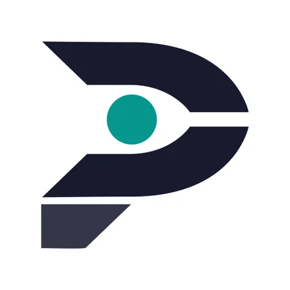</a> `Web` PublishBuddy

内置 AI Agent 的社交媒体管理工具，支持在统一面板中排期、发布和分析 10 多个平台的帖子。

<a href="https://www.builderoom.com/zh-CN/product/publishbuddy?utm_source=github&amp;utm_medium=weekly&amp;utm_campaign=weekly-004">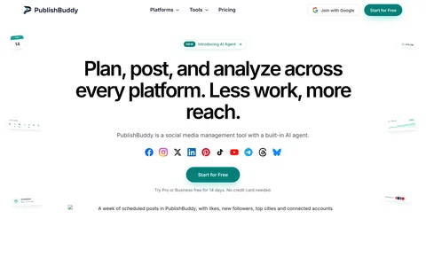</a>
<a href="https://www.builderoom.com/zh-CN/product/publishbuddy?utm_source=github&amp;utm_medium=weekly&amp;utm_campaign=weekly-004">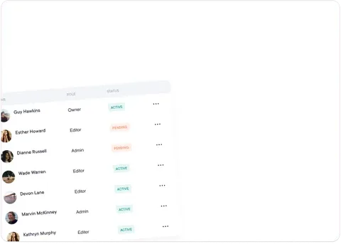</a>

🔍 [在 Builderoom 查看详情](https://www.builderoom.com/zh-CN/product/publishbuddy?utm_source=github&utm_medium=weekly&utm_campaign=weekly-004) · 🔗 [官网](https://publishbuddy.com/?ref=builderoom&utm_source=builderoom&utm_medium=referral&utm_campaign=weekly)

---

### 19.  `Web` pngdeer

开源 PNG 压缩工具，在浏览器中本地运行，寻找保持视觉质量的最小调色板。

<a href="https://www.builderoom.com/zh-CN/product/pngdeer?utm_source=github&amp;utm_medium=weekly&amp;utm_campaign=weekly-004">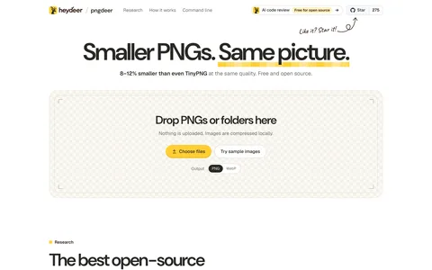</a>

🔍 [在 Builderoom 查看详情](https://www.builderoom.com/zh-CN/product/pngdeer?utm_source=github&utm_medium=weekly&utm_campaign=weekly-004) · 🔗 [官网](https://heydeer.ai/open-source/pngdeer/?ref=builderoom&utm_source=builderoom&utm_medium=referral&utm_campaign=weekly)

---

### 20.  `Web` Angry Dance Filter AI

上传一张照片，生成一段14秒的病毒式愤怒舞蹈视频。

<a href="https://www.builderoom.com/zh-CN/product/angry-dance-filter-ai?utm_source=github&amp;utm_medium=weekly&amp;utm_campaign=weekly-004">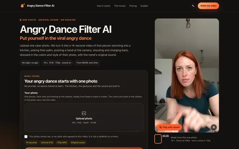</a>

🔍 [在 Builderoom 查看详情](https://www.builderoom.com/zh-CN/product/angry-dance-filter-ai?utm_source=github&utm_medium=weekly&utm_campaign=weekly-004) · 🔗 [官网](https://angrydancefilterai.com/?ref=builderoom&utm_source=builderoom&utm_medium=referral&utm_campaign=weekly)

---

### 21.  `Web` Tiny Desk AI

上传1至3张照片，生成你和朋友出演“Outstanding”办公桌演唱会梗的短视频。

<a href="https://www.builderoom.com/zh-CN/product/tiny-desk-ai?utm_source=github&amp;utm_medium=weekly&amp;utm_campaign=weekly-004">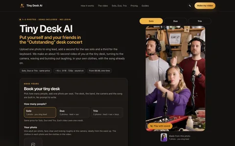</a>

🔍 [在 Builderoom 查看详情](https://www.builderoom.com/zh-CN/product/tiny-desk-ai?utm_source=github&utm_medium=weekly&utm_campaign=weekly-004) · 🔗 [官网](https://tiny-desk-ai.app/?ref=builderoom&utm_source=builderoom&utm_medium=referral&utm_campaign=weekly)

---

### 22.  `Web` Duix

提供真实面部与语音的对话式 AI 数字人平台，支持多角色定制与 API 集成。

🔍 [在 Builderoom 查看详情](https://www.builderoom.com/zh-CN/product/duix?utm_source=github&utm_medium=weekly&utm_campaign=weekly-004) · 🔗 [官网](https://www.duix.com/?ref=builderoom&utm_source=builderoom&utm_medium=referral&utm_campaign=weekly)

---

### 23.  `iOS/Android` Midoo学英语

个性化语言学习助手，通过真实场景对话与小游戏帮助用户练习口语。

🔍 [在 Builderoom 查看详情](https://www.builderoom.com/zh-CN/product/midoo?utm_source=github&utm_medium=weekly&utm_campaign=weekly-004) · 🔗 [App Store](https://apps.apple.com/cn/app/midoo%E5%AD%A6%E8%8B%B1%E8%AF%AD/id6749684855?ref=builderoom&utm_source=builderoom&utm_medium=referral&utm_campaign=weekly)

---

### 24.  `Web` Eaglercraft

在浏览器中免费玩 Minecraft，无需下载，支持 Chromebook、手机和电脑。

🔍 [在 Builderoom 查看详情](https://www.builderoom.com/zh-CN/product/eaglercraft?utm_source=github&utm_medium=weekly&utm_campaign=weekly-004) · 🔗 [官网](https://eaglercraft.com/?ref=builderoom&utm_source=builderoom&utm_medium=referral&utm_campaign=weekly)

---

### 25.  `AI Agent` Replica Skill

11 个免费的 Claude 技能，用于逆向工程、重建、测试并改进任意应用。

🔍 [在 Builderoom 查看详情](https://www.builderoom.com/zh-CN/product/replica-skill?utm_source=github&utm_medium=weekly&utm_campaign=weekly-004) · 🔗 [GitHub](https://github.com/Jakeschincariol/replica-skill?ref=builderoom&utm_source=builderoom&utm_medium=referral&utm_campaign=weekly)

---

### 26.  `Web` Gumloop

多人协作的 AI Agent 构建平台，让团队成员使用任意模型和集成构建 Agent，同时由 IT 控制访问权限。

<a href="https://www.builderoom.com/zh-CN/product/gumloop?utm_source=github&amp;utm_medium=weekly&amp;utm_campaign=weekly-004">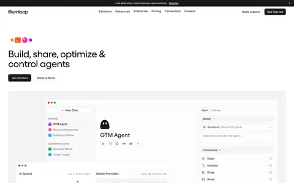</a>
<a href="https://www.builderoom.com/zh-CN/product/gumloop?utm_source=github&amp;utm_medium=weekly&amp;utm_campaign=weekly-004">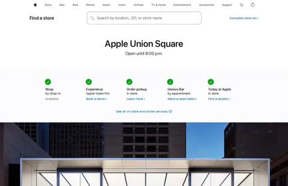</a>

🔍 [在 Builderoom 查看详情](https://www.builderoom.com/zh-CN/product/gumloop?utm_source=github&utm_medium=weekly&utm_campaign=weekly-004) · 🔗 [官网](https://www.gumloop.com/?ref=builderoom&utm_source=builderoom&utm_medium=referral&utm_campaign=weekly)

---

### 27.  `AI Agent` Activepieces

开源 AI 自动化平台，支持通过 MCP 将工作流组件作为 AI Agent 工具使用。

🔍 [在 Builderoom 查看详情](https://www.builderoom.com/zh-CN/product/activepieces?utm_source=github&utm_medium=weekly&utm_campaign=weekly-004) · 🔗 [GitHub](https://github.com/activepieces/activepieces?ref=builderoom&utm_source=builderoom&utm_medium=referral&utm_campaign=weekly)

---

### 28.  `AI Agent` html-explainer

面向 AI 编程智能体的 Agent Skill，将任意主题生成带配音、字幕和封面的讲解视频。

<a href="https://www.builderoom.com/zh-CN/product/html-explainer?utm_source=github&amp;utm_medium=weekly&amp;utm_campaign=weekly-004">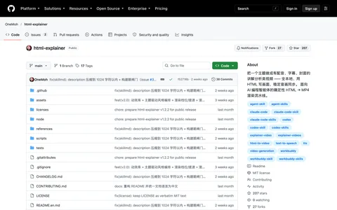</a>

🔍 [在 Builderoom 查看详情](https://www.builderoom.com/zh-CN/product/html-explainer?utm_source=github&utm_medium=weekly&utm_campaign=weekly-004) · 🔗 [GitHub](https://github.com/OneMoh/html-explainer?ref=builderoom&utm_source=builderoom&utm_medium=referral&utm_campaign=weekly)

---

### 29.  `Web` Novastart

无限画布白板操作系统

<a href="https://www.builderoom.com/zh-CN/product/novastart?utm_source=github&amp;utm_medium=weekly&amp;utm_campaign=weekly-004">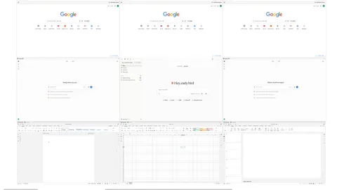</a>

🔍 [在 Builderoom 查看详情](https://www.builderoom.com/zh-CN/product/novastart?utm_source=github&utm_medium=weekly&utm_campaign=weekly-004) · 🔗 [官网](https://novastart.com?ref=builderoom&utm_source=builderoom&utm_medium=referral&utm_campaign=weekly)

---

### 30.  `Web` Creatify

将产品链接转化为视频广告的 AI 工具，帮助品牌和代理机构快速制作广告素材。

🔍 [在 Builderoom 查看详情](https://www.builderoom.com/zh-CN/product/creatify?utm_source=github&utm_medium=weekly&utm_campaign=weekly-004) · 🔗 [官网](https://creatify.ai/zh/features/url-to-video?ref=builderoom&utm_source=builderoom&utm_medium=referral&utm_campaign=weekly)

---

[← 往期回顾](../README.md) · 浏览更多作品：[builderoom.com](https://www.builderoom.com/zh-CN?utm_source=github&utm_medium=weekly&utm_campaign=weekly-004)
