<!-- builderoom-weekly issue=5 start=2026-11-02 end=2026-11-08 -->
# Builderoom 周精选 · 第 5 期

> 2026-11-02 ~ 2026-11-08 · 本期收录 **30** 款新作品

[Builderoom](https://www.builderoom.com/zh-CN?utm_source=github&utm_medium=weekly&utm_campaign=weekly-005)：始于独立创造，开启无限连接。这里展示独立开发者、设计师与创客的作品，每一款都经过人工审核后上架。

> [!TIP]
> **自荐作品**：在 Builderoom [提交你的作品](https://www.builderoom.com/zh-CN/submit?utm_source=github&utm_medium=weekly&utm_campaign=weekly-005)，审核通过后即有机会入选下一期周刊。

---

### 1.  `桌面端` Qwen Code

开源 AI 编程代理，可在终端、桌面应用、编辑器及聊天工具中使用。

<a href="https://www.builderoom.com/zh-CN/product/qwen-code?utm_source=github&amp;utm_medium=weekly&amp;utm_campaign=weekly-005">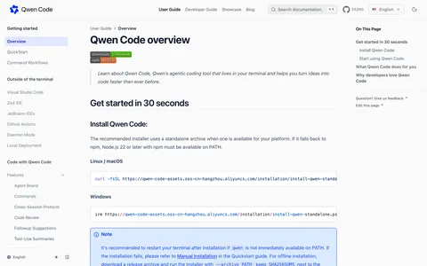</a>
<a href="https://www.builderoom.com/zh-CN/product/qwen-code?utm_source=github&amp;utm_medium=weekly&amp;utm_campaign=weekly-005">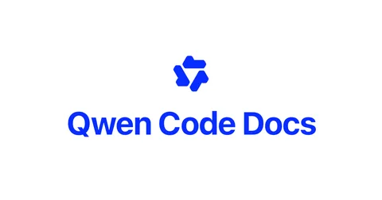</a>

🔍 [在 Builderoom 查看详情](https://www.builderoom.com/zh-CN/product/qwen-code?utm_source=github&utm_medium=weekly&utm_campaign=weekly-005) · 🔗 [GitHub](https://github.com/QwenLM/qwen-code?ref=builderoom&utm_source=builderoom&utm_medium=referral&utm_campaign=weekly)

---

### 2.  `iOS/Android` 即刻App

基于兴趣同好的交友社区，帮助用户发现圈子、记录生活并结识同好。

🔍 [在 Builderoom 查看详情](https://www.builderoom.com/zh-CN/product/app?utm_source=github&utm_medium=weekly&utm_campaign=weekly-005) · 🔗 [App Store](https://apps.apple.com/cn/app/%E5%8D%B3%E5%88%BBapp/id966129812?ref=builderoom&utm_source=builderoom&utm_medium=referral&utm_campaign=weekly)

---

### 3.  `Web` AI Music Maker

输入一段文字描述，即可生成包含人声、歌词和伴奏的完整歌曲。

<a href="https://www.builderoom.com/zh-CN/product/ai-music-maker?utm_source=github&amp;utm_medium=weekly&amp;utm_campaign=weekly-005">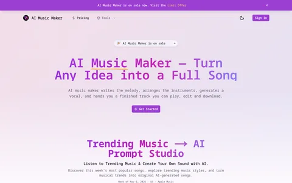</a>

🔍 [在 Builderoom 查看详情](https://www.builderoom.com/zh-CN/product/ai-music-maker?utm_source=github&utm_medium=weekly&utm_campaign=weekly-005) · 🔗 [官网](https://aimusicmaker.org/?ref=builderoom&utm_source=builderoom&utm_medium=referral&utm_campaign=weekly)

---

### 4.  `Web` Mova

AI 求职工具，每天扫描 30+ 招聘网站，为你匹配职位并生成申请策略。

<a href="https://www.builderoom.com/zh-CN/product/mova?utm_source=github&amp;utm_medium=weekly&amp;utm_campaign=weekly-005">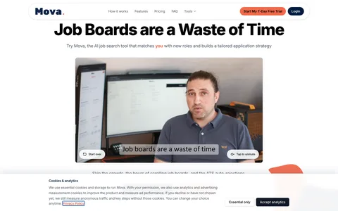</a>
<a href="https://www.builderoom.com/zh-CN/product/mova?utm_source=github&amp;utm_medium=weekly&amp;utm_campaign=weekly-005">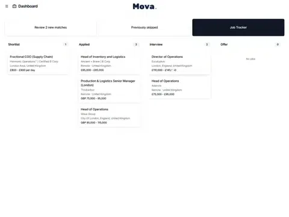</a>

🔍 [在 Builderoom 查看详情](https://www.builderoom.com/zh-CN/product/mova?utm_source=github&utm_medium=weekly&utm_campaign=weekly-005) · 🔗 [官网](https://trymova.app/?ref=builderoom&utm_source=builderoom&utm_medium=referral&utm_campaign=weekly)

---

### 5.  `Web` Vricko

用一句话描述业务想法，AI 代理自动搭建网站、处理消息与客户支持，并留下每项任务的执行证据。

<a href="https://www.builderoom.com/zh-CN/product/vricko?utm_source=github&amp;utm_medium=weekly&amp;utm_campaign=weekly-005">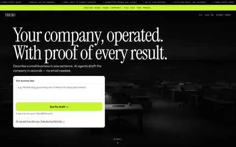</a>

🔍 [在 Builderoom 查看详情](https://www.builderoom.com/zh-CN/product/vricko?utm_source=github&utm_medium=weekly&utm_campaign=weekly-005) · 🔗 [官网](https://app.vricko.app/?ref=builderoom&utm_source=builderoom&utm_medium=referral&utm_campaign=weekly)

---

### 6.  `Web` Sandscape

将想法转化为可玩的浏览器游戏，支持可视化或代码编辑并发布分享。

🔍 [在 Builderoom 查看详情](https://www.builderoom.com/zh-CN/product/sandscape?utm_source=github&utm_medium=weekly&utm_campaign=weekly-005) · 🔗 [官网](https://sandscape.app/?ref=builderoom&utm_source=builderoom&utm_medium=referral&utm_campaign=weekly)

---

### 7.  `Web` Text to GIF

通过文字描述生成原创动画 GIF 的 AI 工具

🔍 [在 Builderoom 查看详情](https://www.builderoom.com/zh-CN/product/text-to-gif?utm_source=github&utm_medium=weekly&utm_campaign=weekly-005) · 🔗 [官网](https://texttogif.com/?ref=builderoom&utm_source=builderoom&utm_medium=referral&utm_campaign=weekly)

---

### 8.  `Web` AnyImg

基于提示词的 AI 图像编辑器，通过自然语言描述来编辑、修饰和生成图片。

🔍 [在 Builderoom 查看详情](https://www.builderoom.com/zh-CN/product/anyimg?utm_source=github&utm_medium=weekly&utm_campaign=weekly-005) · 🔗 [官网](https://anyimg.ai/?ref=builderoom&utm_source=builderoom&utm_medium=referral&utm_campaign=weekly)

---

### 9.  `Web` Img2Img AI

基于网页的 Image to Image AI 生成器，上传图片即可编辑、重绘风格并添加特效。

<a href="https://www.builderoom.com/zh-CN/product/img2img-ai?utm_source=github&amp;utm_medium=weekly&amp;utm_campaign=weekly-005">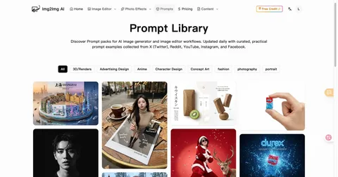</a>
<a href="https://www.builderoom.com/zh-CN/product/img2img-ai?utm_source=github&amp;utm_medium=weekly&amp;utm_campaign=weekly-005">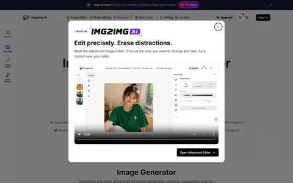</a>

🔍 [在 Builderoom 查看详情](https://www.builderoom.com/zh-CN/product/img2img-ai?utm_source=github&utm_medium=weekly&utm_campaign=weekly-005) · 🔗 [官网](https://imgtoimg-ai.com/?ref=builderoom&utm_source=builderoom&utm_medium=referral&utm_campaign=weekly)

---

### 10.  `Web` photoeditor.ai

基于浏览器的 AI 图片编辑与生成平台，提供 30+ 专用工具，无需注册即可免费使用。

<a href="https://www.builderoom.com/zh-CN/product/photoeditor-ai?utm_source=github&amp;utm_medium=weekly&amp;utm_campaign=weekly-005">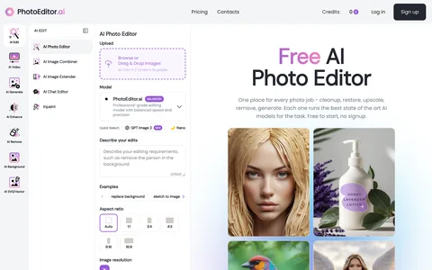</a>

🔍 [在 Builderoom 查看详情](https://www.builderoom.com/zh-CN/product/photoeditor-ai?utm_source=github&utm_medium=weekly&utm_campaign=weekly-005) · 🔗 [官网](https://photoeditor.ai/?ref=builderoom&utm_source=builderoom&utm_medium=referral&utm_campaign=weekly)

---

### 11.  `Web` Cleanup.pictures

基于 AI 的网页修图工具，帮助用户从照片中移除不需要的物体、人物、文字和瑕疵。

<a href="https://www.builderoom.com/zh-CN/product/cleanup-pictures?utm_source=github&amp;utm_medium=weekly&amp;utm_campaign=weekly-005">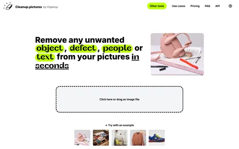</a>
<a href="https://www.builderoom.com/zh-CN/product/cleanup-pictures?utm_source=github&amp;utm_medium=weekly&amp;utm_campaign=weekly-005">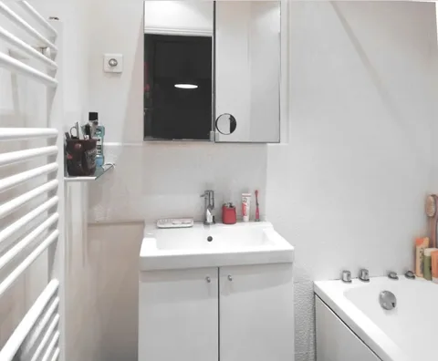</a>

🔍 [在 Builderoom 查看详情](https://www.builderoom.com/zh-CN/product/cleanup-pictures?utm_source=github&utm_medium=weekly&utm_campaign=weekly-005) · 🔗 [官网](https://cleanup.pictures/?ref=builderoom&utm_source=builderoom&utm_medium=referral&utm_campaign=weekly)

---

### 12.  `Web` Zoo

面向硬件设计的 AI 原生 CAD 工程平台，支持草图、提示词与代码在同一工作区中完成设计。

<a href="https://www.builderoom.com/zh-CN/product/zoo?utm_source=github&amp;utm_medium=weekly&amp;utm_campaign=weekly-005">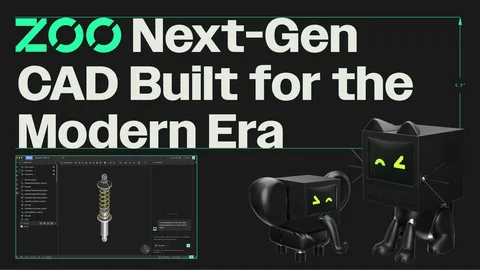</a>
<a href="https://www.builderoom.com/zh-CN/product/zoo?utm_source=github&amp;utm_medium=weekly&amp;utm_campaign=weekly-005">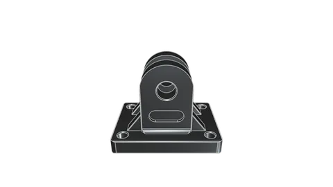</a>

🔍 [在 Builderoom 查看详情](https://www.builderoom.com/zh-CN/product/zoo?utm_source=github&utm_medium=weekly&utm_campaign=weekly-005) · 🔗 [官网](https://zoo.dev/?ref=builderoom&utm_source=builderoom&utm_medium=referral&utm_campaign=weekly)

---

### 13.  `Web` LiveTalking

实时交互流式数字人引擎，通过文本或语音驱动虚拟形象进行音视频同步对话。

🔍 [在 Builderoom 查看详情](https://www.builderoom.com/zh-CN/product/livetalking?utm_source=github&utm_medium=weekly&utm_campaign=weekly-005) · 🔗 [官网](https://github.com/lipku/livetalking?ref=builderoom&utm_source=builderoom&utm_medium=referral&utm_campaign=weekly)

---

### 14.  `Web` 01Router

通过一个 API Key 接入主流 AI 视频、图片、文本与音频模型，并自由选择执行供应商。

🔍 [在 Builderoom 查看详情](https://www.builderoom.com/zh-CN/product/01router?utm_source=github&utm_medium=weekly&utm_campaign=weekly-005) · 🔗 [官网](https://01router.com/zh?ref=builderoom&utm_source=builderoom&utm_medium=referral&utm_campaign=weekly)

---

### 15.  `Web` 提钱退休计划

面向独立开发者与出海创作者的中文资讯聚合平台，实时追踪X博主、长文、羊毛线报与商业项目。

🔍 [在 Builderoom 查看详情](https://www.builderoom.com/zh-CN/product/p-6e859570bb?utm_source=github&utm_medium=weekly&utm_campaign=weekly-005) · 🔗 [官网](https://tuixiu.xyz/?ref=builderoom&utm_source=builderoom&utm_medium=referral&utm_campaign=weekly)

---

### 16.  `Web` Like.Do

帮助用户发现新词、热点话题与潜在机会，并监控关键词和网站趋势的网页应用。

🔍 [在 Builderoom 查看详情](https://www.builderoom.com/zh-CN/product/like-do?utm_source=github&utm_medium=weekly&utm_campaign=weekly-005) · 🔗 [官网](https://like.do/zh?ref=builderoom&utm_source=builderoom&utm_medium=referral&utm_campaign=weekly)

---

### 17. <a href="https://www.builderoom.com/zh-CN/product/makepaper?utm_source=github&amp;utm_medium=weekly&amp;utm_campaign=weekly-005">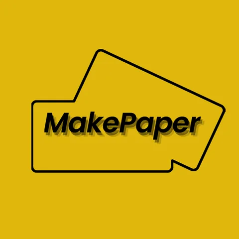</a> `iOS/Android` MakePaper - 壁纸工坊

一款 iOS 壁纸制作工具，帮助用户通过多种背景样式和贴纸功能生成个性化壁纸。

<a href="https://www.builderoom.com/zh-CN/product/makepaper?utm_source=github&amp;utm_medium=weekly&amp;utm_campaign=weekly-005">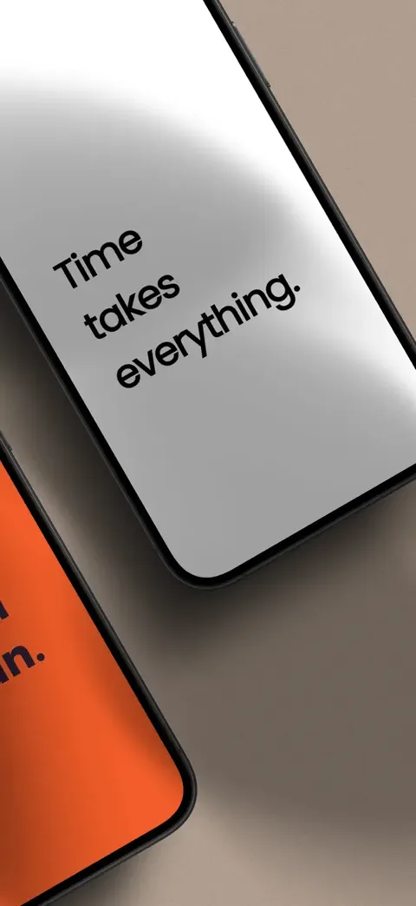</a>

🔍 [在 Builderoom 查看详情](https://www.builderoom.com/zh-CN/product/makepaper?utm_source=github&utm_medium=weekly&utm_campaign=weekly-005) · 🔗 [App Store](https://apps.apple.com/cn/app/makepaper-%E5%A3%81%E7%BA%B8%E5%B7%A5%E5%9D%8A/id6443866547?ref=builderoom&utm_source=builderoom&utm_medium=referral&utm_campaign=weekly)

---

### 18.  `Web` Learn to Speak Easy

通过随机提示、两分钟计时和语音反馈，帮助用户练习即兴演讲。

<a href="https://www.builderoom.com/zh-CN/product/learn-to-speak-easy?utm_source=github&amp;utm_medium=weekly&amp;utm_campaign=weekly-005">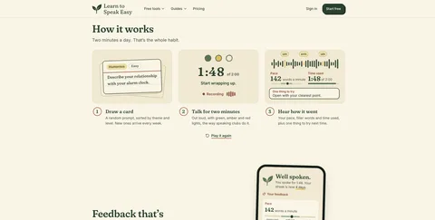</a>
<a href="https://www.builderoom.com/zh-CN/product/learn-to-speak-easy?utm_source=github&amp;utm_medium=weekly&amp;utm_campaign=weekly-005">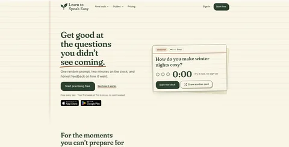</a>

🔍 [在 Builderoom 查看详情](https://www.builderoom.com/zh-CN/product/learn-to-speak-easy?utm_source=github&utm_medium=weekly&utm_campaign=weekly-005) · 🔗 [官网](https://learntospeakeasy.com/?ref=builderoom&utm_source=builderoom&utm_medium=referral&utm_campaign=weekly)

---

### 19.  `Web` 100 Dials

面向 SDR 团队的 AI 冷呼叫模拟器，让新销售在接触真实客户前进行练习与评分。

<a href="https://www.builderoom.com/zh-CN/product/100-dials?utm_source=github&amp;utm_medium=weekly&amp;utm_campaign=weekly-005">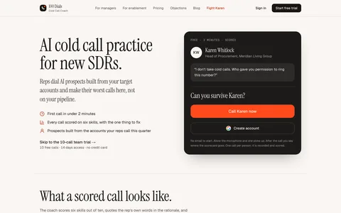</a>
<a href="https://www.builderoom.com/zh-CN/product/100-dials?utm_source=github&amp;utm_medium=weekly&amp;utm_campaign=weekly-005">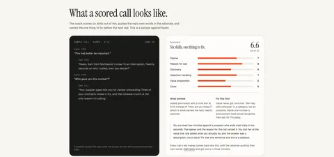</a>

🔍 [在 Builderoom 查看详情](https://www.builderoom.com/zh-CN/product/100-dials?utm_source=github&utm_medium=weekly&utm_campaign=weekly-005) · 🔗 [官网](https://100dials.com/?ref=builderoom&utm_source=builderoom&utm_medium=referral&utm_campaign=weekly)

---

### 20.  `Web` TrendSwap

基于模板的 AI Meme 视频生成工具，用户上传照片即可替换热门梗图中的角色。

🔍 [在 Builderoom 查看详情](https://www.builderoom.com/zh-CN/product/trendswap?utm_source=github&utm_medium=weekly&utm_campaign=weekly-005) · 🔗 [官网](https://trendswap.app/?ref=builderoom&utm_source=builderoom&utm_medium=referral&utm_campaign=weekly)

---

### 21.  `插件` Page Agent

一个运行在网页内的 JavaScript GUI Agent，通过自然语言控制 Web 界面。

🔍 [在 Builderoom 查看详情](https://www.builderoom.com/zh-CN/product/page-agent?utm_source=github&utm_medium=weekly&utm_campaign=weekly-005) · 🔗 [GitHub](https://github.com/alibaba/page-agent?ref=builderoom&utm_source=builderoom&utm_medium=referral&utm_campaign=weekly)

---

### 22.  `桌面端` Meetily

隐私优先的 AI 会议助手，在本地设备上完成会议录音、转录与摘要生成。

<a href="https://www.builderoom.com/zh-CN/product/meetily?utm_source=github&amp;utm_medium=weekly&amp;utm_campaign=weekly-005">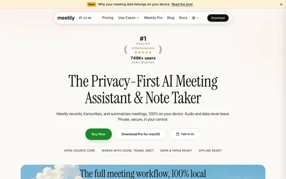</a>

🔍 [在 Builderoom 查看详情](https://www.builderoom.com/zh-CN/product/meetily?utm_source=github&utm_medium=weekly&utm_campaign=weekly-005) · 🔗 [GitHub](https://github.com/Zackriya-Solutions/meetily?ref=builderoom&utm_source=builderoom&utm_medium=referral&utm_campaign=weekly)

---

### 23.  `Web` ReactDrops

为 React 项目提供包含 WebGL、物理模拟和玻璃折射效果的创意组件库。

<a href="https://www.builderoom.com/zh-CN/product/reactdrops?utm_source=github&amp;utm_medium=weekly&amp;utm_campaign=weekly-005">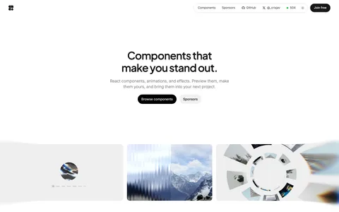</a>

🔍 [在 Builderoom 查看详情](https://www.builderoom.com/zh-CN/product/reactdrops?utm_source=github&utm_medium=weekly&utm_campaign=weekly-005) · 🔗 [官网](https://github.com/crisjavr/reactdrops?tab=License-1-ov-file&ref=builderoom&utm_source=builderoom&utm_medium=referral&utm_campaign=weekly)

---

### 24.  `Web` Spritix

将单张角色图片生成 Idle、Walk、Run、Jump、Attack 动画精灵图的 AI 工具。

<a href="https://www.builderoom.com/zh-CN/product/spritix?utm_source=github&amp;utm_medium=weekly&amp;utm_campaign=weekly-005">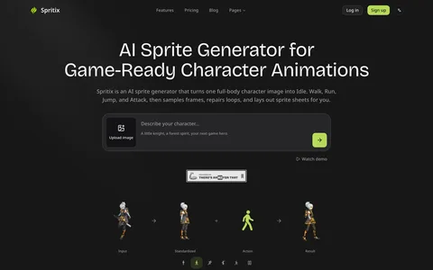</a>

🔍 [在 Builderoom 查看详情](https://www.builderoom.com/zh-CN/product/spritix?utm_source=github&utm_medium=weekly&utm_campaign=weekly-005) · 🔗 [官网](https://spritix.ai/?ref=builderoom&utm_source=builderoom&utm_medium=referral&utm_campaign=weekly)

---

### 25.  `AI Agent` teardown

一个 Claude Code 技能，将任意机器转化为可拆解的离线 3D 模拟器。

🔍 [在 Builderoom 查看详情](https://www.builderoom.com/zh-CN/product/teardown?utm_source=github&utm_medium=weekly&utm_campaign=weekly-005) · 🔗 [GitHub](https://github.com/elvarofficial/teardown?ref=builderoom&utm_source=builderoom&utm_medium=referral&utm_campaign=weekly)

---

### 26.  `Web` ZIPZAX

免费 AI 助手，轻松搞定日常写作、学习、求职与编程任务。

<a href="https://www.builderoom.com/zh-CN/product/zipzax?utm_source=github&amp;utm_medium=weekly&amp;utm_campaign=weekly-005">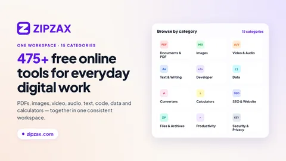</a>

🔍 [在 Builderoom 查看详情](https://www.builderoom.com/zh-CN/product/zipzax?utm_source=github&utm_medium=weekly&utm_campaign=weekly-005) · 🔗 [官网](https://zipzax.com/categories/ai-tools?ref=builderoom&utm_source=builderoom&utm_medium=referral&utm_campaign=weekly)

---

### 27.  `Web` Voice AI Portal

为语音 AI 代理商提供白标客户门户，集中展示通话、聊天记录并按用量向客户计费。

🔍 [在 Builderoom 查看详情](https://www.builderoom.com/zh-CN/product/voice-ai-portal?utm_source=github&utm_medium=weekly&utm_campaign=weekly-005) · 🔗 [官网](https://voiceaiportal.com/?ref=builderoom&utm_source=builderoom&utm_medium=referral&utm_campaign=weekly)

---

### 28.  `Web` Demosmith

AI demo agent，将产品 URL 自动转化为演示视频、交互式演示和文档。

<a href="https://www.builderoom.com/zh-CN/product/demosmith?utm_source=github&amp;utm_medium=weekly&amp;utm_campaign=weekly-005">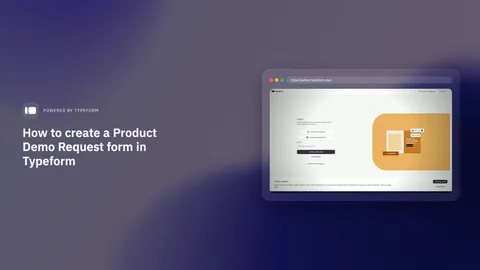</a>

🔍 [在 Builderoom 查看详情](https://www.builderoom.com/zh-CN/product/demosmith?utm_source=github&utm_medium=weekly&utm_campaign=weekly-005) · 🔗 [官网](https://demosmith.ai/?ref=builderoom&utm_source=builderoom&utm_medium=referral&utm_campaign=weekly)

---

### 29.  `Web` kosa8

为 AI agent 提供安全的 microVM 沙箱，支持检查点、秒级回滚与分支。

🔍 [在 Builderoom 查看详情](https://www.builderoom.com/zh-CN/product/kosa8?utm_source=github&utm_medium=weekly&utm_campaign=weekly-005) · 🔗 [官网](https://kosa8.com/?ref=builderoom&utm_source=builderoom&utm_medium=referral&utm_campaign=weekly)

---

### 30.  `Web` Fulcra

面向 AI Agent 的用户自有上下文后端，将数据、文件与 Agent 工作整合到一个可控的上下文中。

<a href="https://www.builderoom.com/zh-CN/product/fulcra?utm_source=github&amp;utm_medium=weekly&amp;utm_campaign=weekly-005">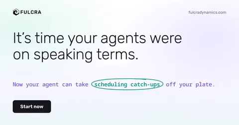</a>

🔍 [在 Builderoom 查看详情](https://www.builderoom.com/zh-CN/product/fulcra?utm_source=github&utm_medium=weekly&utm_campaign=weekly-005) · 🔗 [官网](https://fulcradynamics.com/?ref=builderoom&utm_source=builderoom&utm_medium=referral&utm_campaign=weekly)

---

[← 往期回顾](../README.md) · 浏览更多作品：[builderoom.com](https://www.builderoom.com/zh-CN?utm_source=github&utm_medium=weekly&utm_campaign=weekly-005)
