<!-- builderoom-weekly issue=6 start=2026-11-09 end=2026-11-15 -->
# Builderoom 周精选 · 第 6 期

> 2026-11-09 ~ 2026-11-15 · 本期收录 **23** 款新作品

[Builderoom](https://www.builderoom.com/zh-CN?utm_source=github&utm_medium=weekly&utm_campaign=weekly-006)：始于独立创造，开启无限连接。这里展示独立开发者、设计师与创客的作品，每一款都经过人工审核后上架。

> [!TIP]
> **自荐作品**：在 Builderoom [提交你的作品](https://www.builderoom.com/zh-CN/submit?utm_source=github&utm_medium=weekly&utm_campaign=weekly-006)，审核通过后即有机会入选下一期周刊。

---

### 1.  `Web` Aisma

用自然语言描述修改需求，对已拍摄的视频片段进行 AI 编辑。

<a href="https://www.builderoom.com/zh-CN/product/aisma?utm_source=github&amp;utm_medium=weekly&amp;utm_campaign=weekly-006">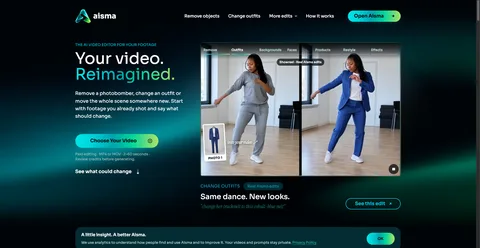</a>

🔍 [在 Builderoom 查看详情](https://www.builderoom.com/zh-CN/product/aisma?utm_source=github&utm_medium=weekly&utm_campaign=weekly-006) · 🔗 [官网](https://aisma.ai/?ref=builderoom&utm_source=builderoom&utm_medium=referral&utm_campaign=weekly)

---

### 2.  `Web` TriRank

AI 可见性追踪工具，检测 AI 问答引擎是否引用了你的网站

<a href="https://www.builderoom.com/zh-CN/product/trirank?utm_source=github&amp;utm_medium=weekly&amp;utm_campaign=weekly-006">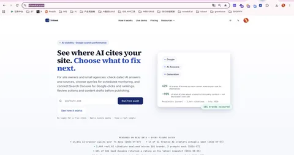</a>

🔍 [在 Builderoom 查看详情](https://www.builderoom.com/zh-CN/product/trirank?utm_source=github&utm_medium=weekly&utm_campaign=weekly-006) · 🔗 [官网](https://trirankai.com/?ref=builderoom&utm_source=builderoom&utm_medium=referral&utm_campaign=weekly)

---

### 3.  `Web` Lyrics to Song AI

将歌词转化为带有 AI 人声和伴奏的歌曲，无需乐理知识或录音设备。

<a href="https://www.builderoom.com/zh-CN/product/lyrics-to-song-ai?utm_source=github&amp;utm_medium=weekly&amp;utm_campaign=weekly-006">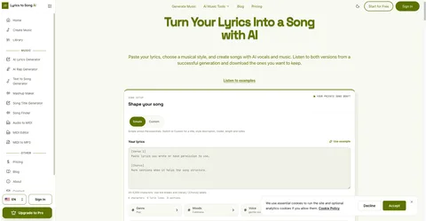</a>

🔍 [在 Builderoom 查看详情](https://www.builderoom.com/zh-CN/product/lyrics-to-song-ai?utm_source=github&utm_medium=weekly&utm_campaign=weekly-006) · 🔗 [官网](https://lyricstosongai.org/?ref=builderoom&utm_source=builderoom&utm_medium=referral&utm_campaign=weekly)

---

### 4.  `插件` dsh-image-gen

一款 DeepSeek Harness 插件，让 AI Agent 能在聊天对话中直接生成、编辑和对比图片。

🔍 [在 Builderoom 查看详情](https://www.builderoom.com/zh-CN/product/dsh-image-gen?utm_source=github&utm_medium=weekly&utm_campaign=weekly-006) · 🔗 [GitHub](https://github.com/shanliuling/dsh-image-gen?ref=builderoom&utm_source=builderoom&utm_medium=referral&utm_campaign=weekly)

---

### 5.  `Web` Velxio

免费开源的在线电路与微控制器模拟器，支持在浏览器中运行真实固件和 SPICE 模拟。

<a href="https://www.builderoom.com/zh-CN/product/velxio?utm_source=github&amp;utm_medium=weekly&amp;utm_campaign=weekly-006">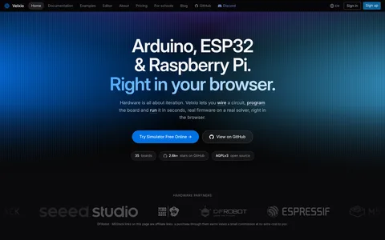</a>
<a href="https://www.builderoom.com/zh-CN/product/velxio?utm_source=github&amp;utm_medium=weekly&amp;utm_campaign=weekly-006">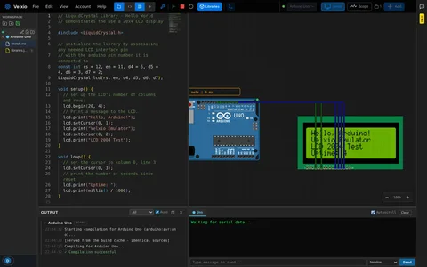</a>

🔍 [在 Builderoom 查看详情](https://www.builderoom.com/zh-CN/product/velxio?utm_source=github&utm_medium=weekly&utm_campaign=weekly-006) · 🔗 [官网](https://velxio.dev/?ref=builderoom&utm_source=builderoom&utm_medium=referral&utm_campaign=weekly)

---

### 6.  `Web` 3DLogoLab

将 2D Logo 转换为 3D 旋转动画，支持导出视频或 3D 模型，无需设计技能。

<a href="https://www.builderoom.com/zh-CN/product/3dlogolab?utm_source=github&amp;utm_medium=weekly&amp;utm_campaign=weekly-006">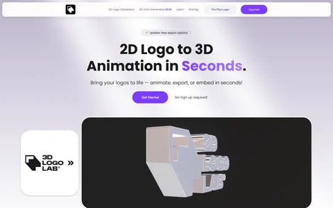</a>
<a href="https://www.builderoom.com/zh-CN/product/3dlogolab?utm_source=github&amp;utm_medium=weekly&amp;utm_campaign=weekly-006">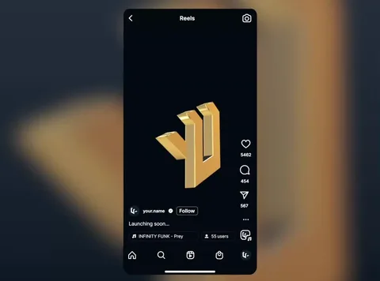</a>

🔍 [在 Builderoom 查看详情](https://www.builderoom.com/zh-CN/product/3dlogolab?utm_source=github&utm_medium=weekly&utm_campaign=weekly-006) · 🔗 [官网](https://3dlogolab.io/?ref=builderoom&utm_source=builderoom&utm_medium=referral&utm_campaign=weekly)

---

### 7.  `Web` Apex Drawn

免费浏览器赛车游戏与赛道制作工具，绘制赛道即可在3D中竞速并导出至其他游戏。

<a href="https://www.builderoom.com/zh-CN/product/apex-drawn?utm_source=github&amp;utm_medium=weekly&amp;utm_campaign=weekly-006">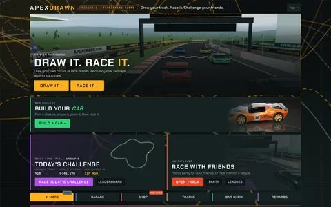</a>

🔍 [在 Builderoom 查看详情](https://www.builderoom.com/zh-CN/product/apex-drawn?utm_source=github&utm_medium=weekly&utm_campaign=weekly-006) · 🔗 [官网](https://apexdrawn.com/?ref=builderoom&utm_source=builderoom&utm_medium=referral&utm_campaign=weekly)

---

### 8.  `Web` Nano Banana 中文站

输入简单文字，生成想要的图片和视频｜支持 Nano Banana｜GPT Image｜Seedance 模型

🔍 [在 Builderoom 查看详情](https://www.builderoom.com/zh-CN/product/nano-banana?utm_source=github&utm_medium=weekly&utm_campaign=weekly-006) · 🔗 [官网](https://nano-banana.cn?ref=builderoom&utm_source=builderoom&utm_medium=referral&utm_campaign=weekly)

---

### 9. <a href="https://www.builderoom.com/zh-CN/product/fitness-os?utm_source=github&amp;utm_medium=weekly&amp;utm_campaign=weekly-006">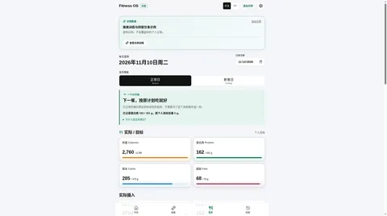</a> `Web` Fitness OS 私教工作台

带过 40+ 位健身会员之后，我把散落在聊天记录和表格里的课程、体测和周计划收进了一个中英双语私教工作台。

🔍 [在 Builderoom 查看详情](https://www.builderoom.com/zh-CN/product/fitness-os?utm_source=github&utm_medium=weekly&utm_campaign=weekly-006) · 🔗 [官网](https://korey2028.tech/fitness/app/?demo=1&lang=zh&ref=builderoom&utm_source=builderoom&utm_medium=referral&utm_campaign=weekly)

---

### 10. <a href="https://www.builderoom.com/zh-CN/product/pixelfx?utm_source=github&amp;utm_medium=weekly&amp;utm_campaign=weekly-006">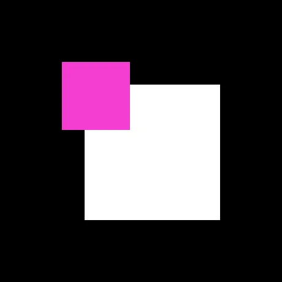</a> `Web` pixelfx

提供 244 个像素风特效代码片段，支持在浏览器游戏中直接运行或导出 sprite sheet。

<a href="https://www.builderoom.com/zh-CN/product/pixelfx?utm_source=github&amp;utm_medium=weekly&amp;utm_campaign=weekly-006">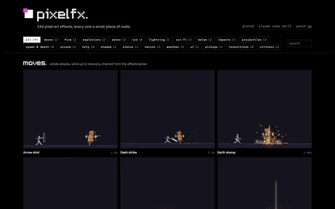</a>
<a href="https://www.builderoom.com/zh-CN/product/pixelfx?utm_source=github&amp;utm_medium=weekly&amp;utm_campaign=weekly-006">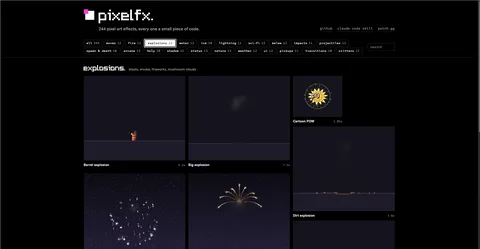</a>

🔍 [在 Builderoom 查看详情](https://www.builderoom.com/zh-CN/product/pixelfx?utm_source=github&utm_medium=weekly&utm_campaign=weekly-006) · 🔗 [官网](https://github.com/patch-gg/pixelfx?ref=builderoom&utm_source=builderoom&utm_medium=referral&utm_campaign=weekly)

---

### 11.  `Web` Sand3D

包含 10 万个以代码编写的 3D 资产开源数据集，专为 LLM 设计。

<a href="https://www.builderoom.com/zh-CN/product/sand3d?utm_source=github&amp;utm_medium=weekly&amp;utm_campaign=weekly-006">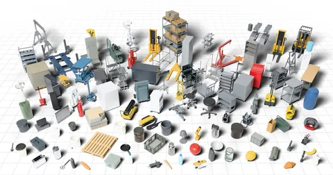</a>
<a href="https://www.builderoom.com/zh-CN/product/sand3d?utm_source=github&amp;utm_medium=weekly&amp;utm_campaign=weekly-006">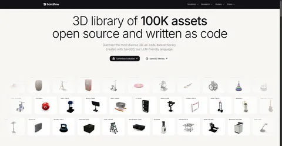</a>

🔍 [在 Builderoom 查看详情](https://www.builderoom.com/zh-CN/product/sand3d?utm_source=github&utm_medium=weekly&utm_campaign=weekly-006) · 🔗 [官网](https://sandflow.ai/sand3d/?ref=builderoom&utm_source=builderoom&utm_medium=referral&utm_campaign=weekly)

---

### 12.  `Web` 资源工具社

汇集效率工具与素材资源的开发者社区

🔍 [在 Builderoom 查看详情](https://www.builderoom.com/zh-CN/product/p-ff46aed8fb?utm_source=github&utm_medium=weekly&utm_campaign=weekly-006) · 🔗 [官网](https://restool.cn/?ref=builderoom&utm_source=builderoom&utm_medium=referral&utm_campaign=weekly)

---

### 13.  `Web` 8090GAME

免费怀旧游戏在线平台：街机、FC、SFC、MD、GBA 等 10 大平台 5000+ 款经典游戏，打开浏览器即玩，无需下载模拟器。

🔍 [在 Builderoom 查看详情](https://www.builderoom.com/zh-CN/product/8090game?utm_source=github&utm_medium=weekly&utm_campaign=weekly-006) · 🔗 [官网](https://www.8090game.com?ref=builderoom&utm_source=builderoom&utm_medium=referral&utm_campaign=weekly)

---

### 14.  `Web` Hyper3D Rodin

通过文本或图片生成高质量 3D 模型的 AI 工具，支持多种导出格式与工作流集成。

<a href="https://www.builderoom.com/zh-CN/product/hyper3d-rodin?utm_source=github&amp;utm_medium=weekly&amp;utm_campaign=weekly-006">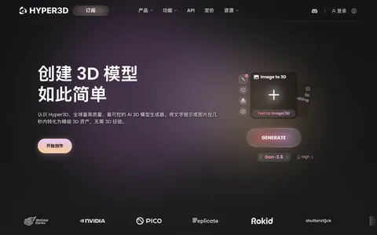</a>
<a href="https://www.builderoom.com/zh-CN/product/hyper3d-rodin?utm_source=github&amp;utm_medium=weekly&amp;utm_campaign=weekly-006">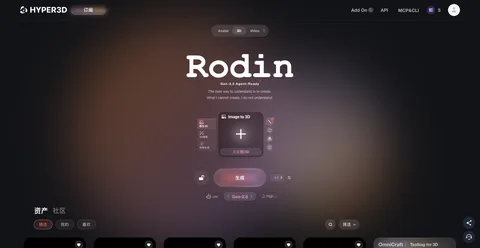</a>

🔍 [在 Builderoom 查看详情](https://www.builderoom.com/zh-CN/product/hyper3d-rodin?utm_source=github&utm_medium=weekly&utm_campaign=weekly-006) · 🔗 [官网](https://hyper3d.ai/?ref=builderoom&utm_source=builderoom&utm_medium=referral&utm_campaign=weekly)

---

### 15.  `Web` MuJoCo

通过 WebAssembly 在浏览器中原生运行的 MuJoCo 4.0 交互式物理仿真展示。

<a href="https://www.builderoom.com/zh-CN/product/mujoco?utm_source=github&amp;utm_medium=weekly&amp;utm_campaign=weekly-006">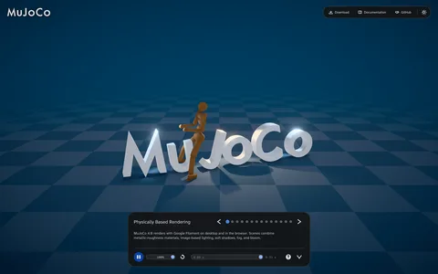</a>
<a href="https://www.builderoom.com/zh-CN/product/mujoco?utm_source=github&amp;utm_medium=weekly&amp;utm_campaign=weekly-006">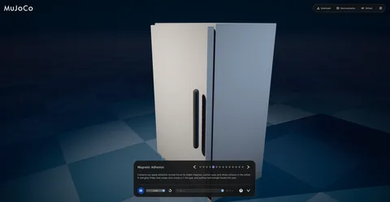</a>

🔍 [在 Builderoom 查看详情](https://www.builderoom.com/zh-CN/product/mujoco?utm_source=github&utm_medium=weekly&utm_campaign=weekly-006) · 🔗 [官网](https://mujoco.org/?ref=builderoom&utm_source=builderoom&utm_medium=referral&utm_campaign=weekly)

---

### 16.  `AI Agent` dsh-go

DeepSeek Harness 的 Android 客户端，可在设备本地运行或连接远程计算机。

<a href="https://www.builderoom.com/zh-CN/product/dsh-go?utm_source=github&amp;utm_medium=weekly&amp;utm_campaign=weekly-006">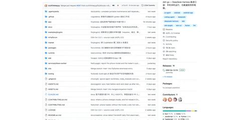</a>

🔍 [在 Builderoom 查看详情](https://www.builderoom.com/zh-CN/product/dsh-go?utm_source=github&utm_medium=weekly&utm_campaign=weekly-006) · 🔗 [GitHub](https://github.com/ccch1mneyyy/dsh-Go?ref=builderoom&utm_source=builderoom&utm_medium=referral&utm_campaign=weekly)

---

### 17.  `Web` Gesso

AI 创意团队，根据文字描述生成可直接用于生产的产品 UI。

<a href="https://www.builderoom.com/zh-CN/product/gesso?utm_source=github&amp;utm_medium=weekly&amp;utm_campaign=weekly-006">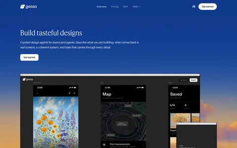</a>

🔍 [在 Builderoom 查看详情](https://www.builderoom.com/zh-CN/product/gesso?utm_source=github&utm_medium=weekly&utm_campaign=weekly-006) · 🔗 [官网](https://gesso.build/?ref=builderoom&utm_source=builderoom&utm_medium=referral&utm_campaign=weekly)

---

### 18.  `Web` RapVid

一张照片即可生成口型同步的说唱视频

<a href="https://www.builderoom.com/zh-CN/product/rapvid?utm_source=github&amp;utm_medium=weekly&amp;utm_campaign=weekly-006">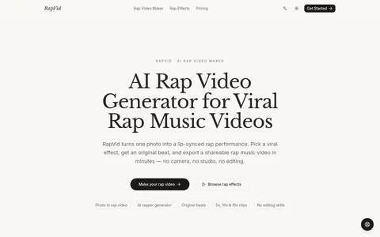</a>

🔍 [在 Builderoom 查看详情](https://www.builderoom.com/zh-CN/product/rapvid?utm_source=github&utm_medium=weekly&utm_campaign=weekly-006) · 🔗 [官网](https://www.rapvid.pro/?ref=builderoom&utm_source=builderoom&utm_medium=referral&utm_campaign=weekly)

---

### 19. <a href="https://www.builderoom.com/zh-CN/product/tesana?utm_source=github&amp;utm_medium=weekly&amp;utm_campaign=weekly-006">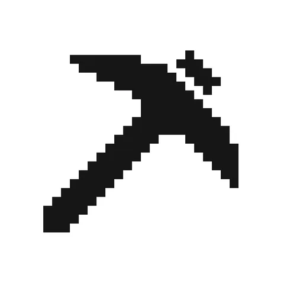</a> `Web` Tesana

一款 AI 驱动的平台，无需编码即可创建、发布和游玩浏览器游戏。

<a href="https://www.builderoom.com/zh-CN/product/tesana?utm_source=github&amp;utm_medium=weekly&amp;utm_campaign=weekly-006">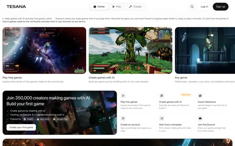</a>
<a href="https://www.builderoom.com/zh-CN/product/tesana?utm_source=github&amp;utm_medium=weekly&amp;utm_campaign=weekly-006">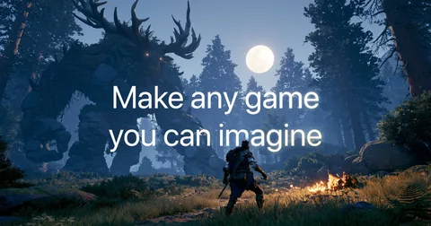</a>

🔍 [在 Builderoom 查看详情](https://www.builderoom.com/zh-CN/product/tesana?utm_source=github&utm_medium=weekly&utm_campaign=weekly-006) · 🔗 [官网](https://tesana.com/?ref=builderoom&utm_source=builderoom&utm_medium=referral&utm_campaign=weekly)

---

### 20.  `Web` Bitcut

用 AI 将长视频自动剪辑为竖版 Shorts、Reels 和 TikTok 短视频

🔍 [在 Builderoom 查看详情](https://www.builderoom.com/zh-CN/product/bitcut?utm_source=github&utm_medium=weekly&utm_campaign=weekly-006) · 🔗 [官网](https://bitcut.app/?ref=builderoom&utm_source=builderoom&utm_medium=referral&utm_campaign=weekly)

---

### 21.  `Web` DesignUGC

使用 AI 数字人、产品图片和文本提示，生成逼真的 AI UGC 视频广告。

🔍 [在 Builderoom 查看详情](https://www.builderoom.com/zh-CN/product/designugc?utm_source=github&utm_medium=weekly&utm_campaign=weekly-006) · 🔗 [官网](https://designugc.com/?ref=builderoom&utm_source=builderoom&utm_medium=referral&utm_campaign=weekly)

---

### 22.  `Web` Deepnia

AI 驱动的多媒体内容平台，一站式完成社交媒体内容的创作、发布与数据分析。

🔍 [在 Builderoom 查看详情](https://www.builderoom.com/zh-CN/product/deepnia?utm_source=github&utm_medium=weekly&utm_campaign=weekly-006) · 🔗 [官网](https://deepnia.com/?ref=builderoom&utm_source=builderoom&utm_medium=referral&utm_campaign=weekly)

---

### 23.  `Web` VoooAI

一句话生成 AI 短剧、漫画和视频的多模型创作平台

🔍 [在 Builderoom 查看详情](https://www.builderoom.com/zh-CN/product/voooai?utm_source=github&utm_medium=weekly&utm_campaign=weekly-006) · 🔗 [官网](https://voooai.com/?ref=builderoom&utm_source=builderoom&utm_medium=referral&utm_campaign=weekly)

---

[← 往期回顾](../README.md) · 浏览更多作品：[builderoom.com](https://www.builderoom.com/zh-CN?utm_source=github&utm_medium=weekly&utm_campaign=weekly-006)
